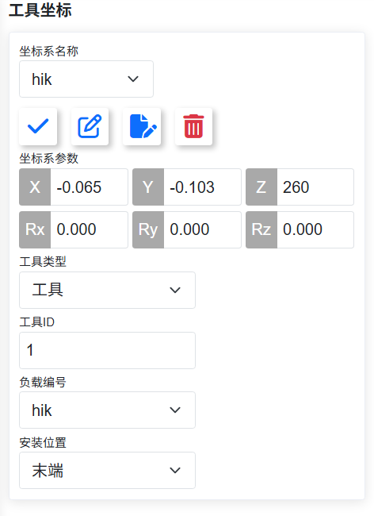
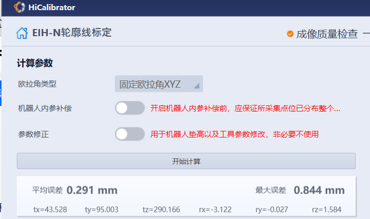

# 标定记录

本目录保存 `dianyun` 现场标定的原始界面截图与参数记录，用于复现标定结果、核对坐标系方向，以及排查采集点云与机器人位姿不一致的问题。

> 单位约定：法奥（FAIRINO）SDK 的笛卡尔位姿统一为 **mm + 度**。本记录中除特别说明外，长度单位为毫米，角度单位为度。

## 1. 法奥机械臂末端工具坐标（TCP 标定）



| 项目 | 取值 |
| --- | --- |
| 坐标系名称 | `hik` |
| X | -0.065 |
| Y | -0.103 |
| Z | 250 |
| Rx | 0.000 |
| Ry | 0.000 |
| Rz | 0.000 |
| 工具类型 | 工具 |
| 工具 ID | 1 |
| 负载编号 | `hik` |
| 安装位置 | 末端 |

说明：

- 姿态分量 Rx/Ry/Rz 全部为零，说明该 TCP 只做了平移偏置，工具轴向与机器人法兰坐标系保持平行。选择安装位姿时不应再额外引入旋转。
- Z 方向 250 mm 为主偏置量（真实尖端到法兰盘的距离），X/Y 方向仅 -0.065 / -0.103 mm，属于装配误差量级。注意程序内部曾按 260 mm 配置，导致传感器外参 tz 重复计入工具长，详见 3.1 节。
- 该坐标系通过示教器「工具坐标」页面写入控制器，与 `RobotWorker` 使用的只读监控接口无关；`RobotWorker` 只从 SDK 状态包读取 `tcpPose`，不会下发 `SetToolCoord()` / `SetToolList()`。
- 后续若要由程序写入该工具坐标，v1.x SDK 对应接口为 `FRRobot.h` 中的 `SetToolCoord(...)` 或 `SetToolList(...)`，其中 `type` 取「工具」、`install` 取「末端」。当前版本未实现写操作。

## 2. 相机（线轮廓传感器）标定



标定工具：HiCalibrator，标定项为 **EIH-N 轮廓线标定**。

| 项目 | 取值 |
| --- | --- |
| 欧拉角类型 | 固定欧拉角 XYZ |
| 机器人内参补偿 | 关闭 |
| 参数修正 | 关闭 |
| 平均误差 | 0.291 mm |
| 最大误差 | 0.844 mm |
| tx | 43.528 |
| ty | 95.003 |
| tz | 290.166 |
| rx | -3.122 |
| ry | -0.027 |
| rz | 1.584 |

说明：

- 平均误差 0.291 mm、最大误差 0.844 mm，属于轮廓线标定的可用范围；最大误差约为平均误差的 2.9 倍，说明个别采集点偏离较大，若后续焊缝跟踪出现局部偏差，应优先复标而不是放宽匹配阈值。
- 「机器人内参补偿」要求采集点位分布覆盖整个量程，本次未开启，即按机器人上报位姿直接计算，未做额外内参修正。
- 「参数修正」用于机器人垫高和工具参数改动后的补偿。本次标定前已按第 1 节设置工具坐标 `hik`，因此未再启用该修正项。
- rx = -3.122°、rz = 1.584° 为传感器安装的角度偏差，属于正常装配误差；固定欧拉角 XYZ 的旋转顺序必须与使用方一致，否则反算外参时会引入姿态误差。
- 表中 tz = 290.166 mm 是标定软件的**原始输出**，其中包含了工具长（标定时工具 Z = 260 mm）。投入 `calibration.json` 时必须扣掉工具长，见 3.1 节。

## 3. 一致性核对

- 工具坐标 Z 现为 **250 mm**（真实尖端距法兰盘 250 mm，2026-11-04 由 260 修正）。线轮廓标定原始结果 tz = 290.166 mm 是在工具 Z = 260 时采集的，因此允许值需扣掉工具长：**tz = 290.166 − 250 = 40.166 mm**。若不扣除，扫描点云在基坐标 Z 上会整体偏移一个工具长（实测旧数据偏低约 260 mm）。
- 工具坐标系与线轮廓标定都必须绑定同一机器人（同一 IP、同一 `toolID`、同一负载编号 `hik`），更换控制器或重刷配置后需要重新核对。
- 线轮廓标定结果按 `T_tcp1_sensor`（工具 1 激活下标定）使用。`dianyun` 扫描时记录每个时刻的 6D TCP 位姿，逐行按 `p_base = T_base_tcp(t) · T_tcp_sensor · M_axis · (x, 0, z)` 直接输出机器人基坐标点云，焊缝映射结果因此也在基坐标下，可以下发机器人执行。
- 外参写在 exe 同目录的 `calibration.json` 中（首次运行自动生成模板），修改后用菜单「通信 → 重新加载手眼标定」生效：

  ```json
  {
    "handEye": { "tx": 42.52, "ty": 88.47, "tz": 41.82, "rx": -3.122, "ry": -0.027, "rz": 1.584 },
    "sensorAxis": [[0, 1, 0], [1, 0, 0], [0, 0, -1]],
    "timeOffsetUs": 0
  }
  ```

  `sensorAxis`（`M_axis`）是 SDK 输出轴到标定软件传感器轴的映射，必须是行列式为 +1 的正交矩阵；HiCalibrator 的传感器轴约定与 SDK 不一致时在这里修正。`timeOffsetUs` 是行时间戳相对遥测的偏置。

### 3.1 平移修正记录（2026-11-04）

tz 扣除工具长后，用两个已知焊缝起点做现场复核：把真实尖端分别人工移到相机映射出的两个起点上，记录 Web 端 TCP 位姿。

| 项目 | 焊缝 1 起点 | 焊缝 2 起点 |
| --- | --- | --- |
| 相机映射点 P | (-204.10, 962.17, 34.38) | (-214.54, 822.29, 61.09) |
| 实测 TCP T | (-214.315, 960.879, 33.648) | (-217.427, 821.849, 58.518) |
| 误差 e = P − T | (10.215, 1.291, 0.732)，10.32 mm | (2.887, 0.441, 2.572)，3.89 mm |

判读：

- Z 向残差仅 0.73 / 2.57 mm，说明「tz 扣工具长」的修正是正确的，Z 已无系统性偏差。
- 水平误差中 X 分量占 99%，Y 基本不偏，量级 3~10 mm，形态是**常量平移**而非旋转。
- 两点差异 7.60 mm 折算出的约 3° 偏航不可信：人工拖动对位本身有「几毫米」噪声，两点样本不足以支撑旋转项，故本轮**只改平移、不动 rx/ry/rz 与 sensorAxis**。

按纯平移最小二乘（用扫描姿态 Rscan = R(180, 0, 88.77) 把平均误差折回工具系，得 dt = (1.01, 6.53, −1.65)，拟合残差约 ±3.7 mm）：

| 字段 | 修正前 | 修正后 |
| --- | --- | --- |
| tx | 43.528 | 42.52 |
| ty | 95.003 | 88.47 |
| tz | 40.166 | 41.82 |
| rx / ry / rz | -3.122 / -0.027 / 1.584 | 不变 |

修正后现场复测：「移动至焊缝起点上方（30 mm）」的尖端偏差已降到可接受范围。若要进一步确认那约 3° 的偏航是否真实存在，需补第三个已知点重算。

### 3.2 投入使用前的现场核对

1. 扫一幅基坐标点云，日志中点云平均 Z 必须低于扫描起点 TCP Z；否则 `sensorAxis` 很可能反了。
2. 选一条位置已知的焊缝，设好起焊点并完成映射，用「移动至焊缝起点上方（30 mm）」让 TCP 过去，目测尖端是否落在焊缝起点正上方 30 mm。偏差大于 1~2 mm 时先复核 `sensorAxis` 与外参。
3. 同一工件正、反两个方向各扫一次，比较特征点的基坐标：沿行进方向的差值 ≈ 2 × 速度 × 时间偏置，据此标定 `timeOffsetUs`。
4. 执行焊缝前先用「焊缝空走」（整体抬高 20 mm）核对路径。

## 4. 截图来源

| 文件 | 内容 |
| --- | --- |
| `images/fairino-tool-coordinate.png` | 法奥示教器「工具坐标」页面，坐标系 `hik` |
| `images/hicalibrator-eihn-result.png` | HiCalibrator「EIH-N 轮廓线标定」计算结果 |
