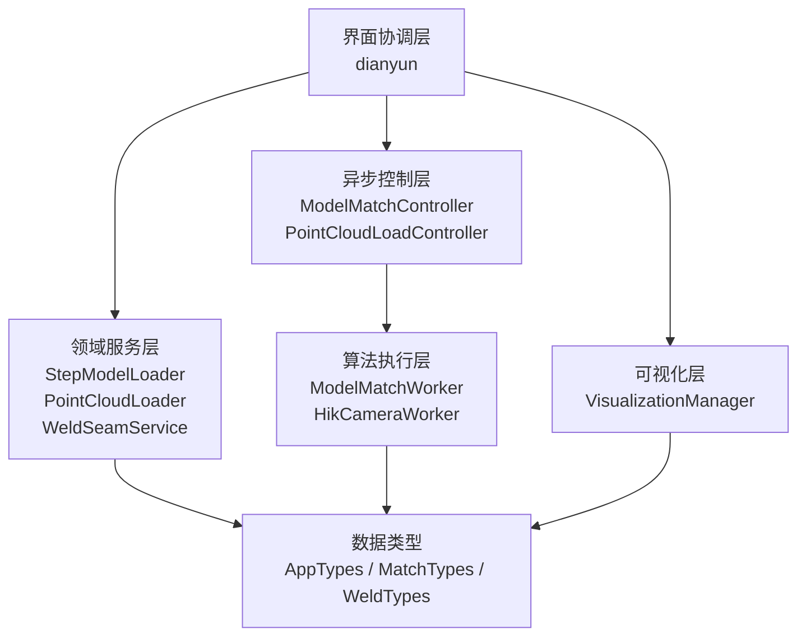
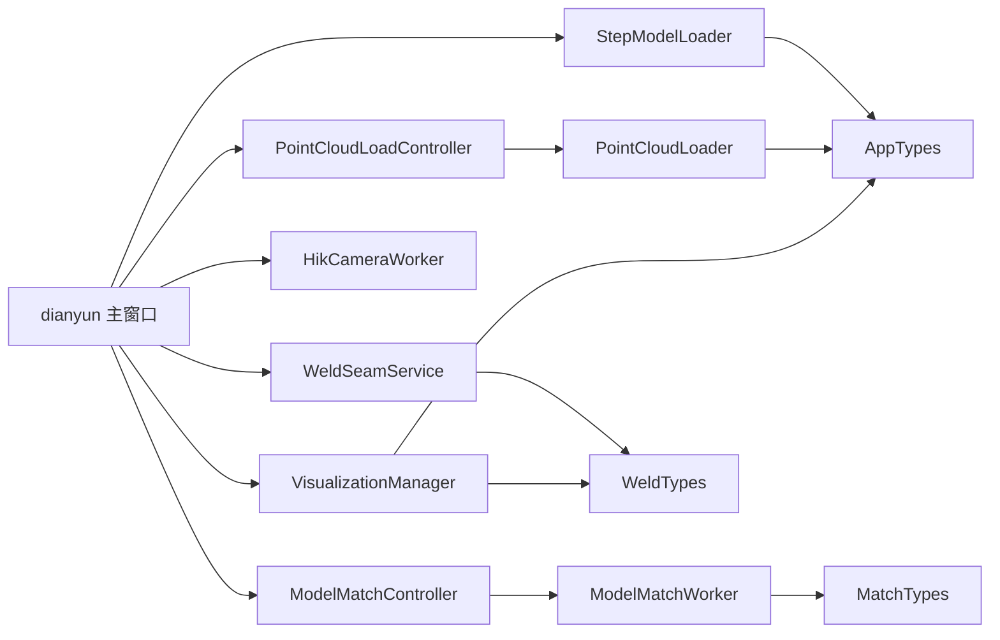

# 代码结构与模块职责

## 1. 仓库结构

```text
E:\data document\
├─ dianyun\
│  ├─ dianyun.sln
│  ├─ README.md
│  ├─ dianyun\
│  │  ├─ main.cpp
│  │  ├─ dianyun.h / dianyun.cpp / dianyun.ui
│  │  ├─ AppTypes.h
│  │  ├─ MatchTypes.h
│  │  ├─ WeldTypes.h
│  │  ├─ StepModelLoader.h / .cpp
│  │  ├─ PointCloudLoader.h / .cpp
│  │  ├─ PointCloudLoadController.h / .cpp
│  │  ├─ ModelMatchController.h / .cpp
│  │  ├─ ModelMatchWorker.h / .cpp
│  │  ├─ MatchRequestTracker.h
│  │  ├─ HikCameraWorker.h / .cpp
│  │  ├─ CameraCaptureState.h
│  │  ├─ WeldSeamService.h / .cpp
│  │  ├─ WeldSeamMapping.cpp
│  │  ├─ VisualizationManager.h / .cpp
│  │  ├─ dianyun.vcxproj
│  │  └─ dianyun.vcxproj.filters
│  └─ tests\
│     ├─ dianyun.tests.vcxproj
│     └─ WeldSeamMappingTests.cpp
└─ docs\
   └─ delivery\
      └─ 本交付文档
```

## 2. 总体分层



## 3. 文件职责

### 3.1 程序入口

#### `main.cpp`

职责：

- 初始化 Qt 应用；
- 设置 OpenGL SurfaceFormat；
- 创建并显示主窗口；
- 进入 Qt 事件循环。

不应放入：

- 点云算法；
- 文件读取；
- 相机业务逻辑；
- UI 状态判断。

### 3.2 主窗口协调

#### `dianyun.h`

定义：

- 主窗口类；
- Qt 槽函数；
- 当前 CAD、点云、匹配、焊缝和映射状态；
- 两个 PCL Viewer；
- 控制器、服务和可视化管理器；
- 焊缝选面状态机。

#### `dianyun.cpp`

职责：

- 连接 UI 事件和各模块；
- 初始化两个 QVTK/PCL 显示窗口；
- 调用 CAD/点云导入模块；
- 启动模型匹配和相机采集；
- 接收异步结果；
- 管理按钮可用性；
- 维护日志与状态栏；
- 维护焊缝列表和选面流程；
- 保证输入替换后旧匹配结果失效。

关键函数：

| 函数 | 职责 |
| --- | --- |
| `initializeViewers()` | 创建 CAD 与点云两个 Viewer |
| `updateActionStates()` | 集中管理导入、拍摄、匹配、映射按钮 |
| `invalidateMatchResult()` | 使旧匹配和旧映射结果失效 |
| `on_btnOpen_clicked()` | 导入 STEP |
| `on_btnOpen_2_clicked()` | 启动点云后台导入 |
| `on_btnOpen_3_clicked()` | 启动模型匹配 |
| `on_btnOpenCamera_clicked()` | 启动相机采集 |
| `on_btnNewSeam_clicked()` | 进入焊缝选面状态 |
| `mouseEventOccurred()` | 通过 Ctrl+单击拾取 CAD 面 |
| `on_btnMapSeam_clicked()` | 映射当前选中焊缝 |
| `onMatchFinished()` | 保存、判定并显示匹配结果 |

维护要求：

- `dianyun.cpp` 只负责流程协调，不应继续堆积新的配准算法；
- 新增独立业务功能时，应优先创建 Service、Controller 或 Worker；
- 所有按钮状态修改应集中到 `updateActionStates()`。

### 3.3 数据类型

#### `AppTypes.h`

定义：

- `CloudRGB`：`pcl::PointCloud<pcl::PointXYZRGB>`；
- `CadModelData`：OpenCascade 形状、面列表、三角网格、面映射、CAD 采样点、尺寸；
- `CadModelData::isValid()`：统一 CAD 有效性判断。

#### `MatchTypes.h`

定义：

- `MatchConfig`：配准可调参数；
- `MatchVerdict`：`Pass`、`NeedsReview`、`Fail`；
- `MatchResult`：最终矩阵、质量指标、诊断和判定。

最重要的坐标约定：

```text
MatchResult::T_final = CAD -> 扫描点云
```

#### `WeldTypes.h`

定义：

- `WeldSeamSegment`：一个焊缝线段的起点和终点；
- `WeldSeamData`：焊缝 ID、名称、采样点、线段和长度。

### 3.4 CAD 导入

#### `StepModelLoader.h/.cpp`

职责：

- 读取 STEP；
- 检查实体；
- 计算模型对角线；
- 三角化；
- 生成显示网格；
- 建立三角单元到 CAD 面的映射；
- 按表面积采样 CAD 点云。

依赖：

- OpenCascade；
- PCL；
- Eigen。

输出：

- `CadModelData`。

### 3.5 点云导入

#### `PointCloudLoader.h/.cpp`

职责：

- 识别 PLY/PCD；
- 调用 PCL 文件读取；
- 删除非有限点和接近原点的无效点；
- 规范点云的 `width`、`height` 和 `is_dense`；
- 计算点云对角线。

该类是同步、无 UI 的纯读取器。

#### `PointCloudLoadController.h/.cpp`

职责：

- 使用 `QtConcurrent::run` 在后台调用 `PointCloudLoader`；
- 使用 `QFutureWatcher` 接收结果；
- 发送进度、成功、失败和忙碌状态；
- 析构时等待仍在运行的任务完成。

该类解决的是“文件读取阻塞主线程”，不负责点云显示。

### 3.6 模型匹配

#### `ModelMatchController.h/.cpp`

职责：

- 拥有独立 `QThread`；
- 将 `ModelMatchWorker` 移动到工作线程；
- 启动和停止线程；
- 传递只读 CAD/扫描点云共享指针；
- 为进度、处理中点云和最终结果附加请求编号；
- 向主窗口发送忙碌状态。

重要约束：

- 同一时间只运行一个匹配；
- 输入点云由主窗口替换智能指针，不在原对象上修改；
- Controller 不实现配准算法。

#### `ModelMatchWorker.h/.cpp`

职责：

- 完整模型匹配流水线；
- 预处理；
- 特征提取；
- 多来源粗配准；
- CAD 引导裁剪；
- 点到点 ICP；
- 点到面 ICP；
- 质量评估；
- 最终判定。

这是项目中算法最密集的文件。后续若继续扩大，应考虑拆为：

- `PointCloudPreprocessor`；
- `CoarseRegistrationService`；
- `FineRegistrationService`；
- `MatchQualityEvaluator`。

当前不建议在尚未建立更完整测试前立即拆分，因为这些阶段共享 `m_leafSize`、降采样点云、关键点和候选状态。

#### `MatchRequestTracker.h`

职责：

- 为匹配任务生成单调递增编号；
- 记录输入数据版本；
- 输入替换后使旧任务失效；
- 拒绝过期进度、预览点云和结果。

该类不启动线程，只解决异步结果归属问题。

### 3.7 相机采集

#### `HikCameraWorker.h/.cpp`

职责：

- 枚举、创建、打开和关闭海康相机；
- 配置触发模式；
- 注册回调；
- 校验帧格式和长度；
- 将原始 X/Z 数据转换为空间点；
- 按目标行程积累多帧；
- 输出完整点云；
- 管理 SDK 失败清理和线程互斥。

#### `CameraCaptureState.h`

职责：

- 使用 `std::atomic<bool>` 防止重复启动采集；
- 提供 `tryBegin()`、`finish()` 和 `isActive()`。

### 3.8 焊缝服务

#### `WeldSeamService.h`

公开两个领域操作：

- `createSeam()`；
- `mapSeam()`。

#### `WeldSeamService.cpp`

职责：

- 根据两个 OpenCascade 面计算交线；
- 按曲线长度确定采样数；
- 生成采样点、连续线段和总长度。

#### `WeldSeamMapping.cpp`

职责：

- 验证输入矩阵是合法刚性变换；
- 将 CAD 焊缝点和线段转换到扫描坐标系；
- 保持焊缝元数据和拓扑数量。

映射代码与 CAD 面求交代码分离，便于无 OpenCascade 几何计算的单元测试。

### 3.9 可视化

#### `VisualizationManager.h/.cpp`

职责：

- 管理两个 PCL Viewer；
- 显示 CAD 网格；
- 渐进显示完整点云；
- 显示处理后工件点云；
- 显示半透明对齐 CAD；
- 高亮 CAD 面；
- 将焊缝线段拼成连续折线；
- 使用 VTK TubeFilter 将焊缝显示为三维管道；
- 同步 CAD 和点云视图的焊缝选中颜色。

关键显示参数：

- 点云批次：100000 点；
- 处理后点云点大小：3；
- 对齐 CAD 透明度：0.5；
- 焊缝管道半径：显示尺度的 0.25%；
- 管道圆周边数：12。

所有 PCL/VTK actor ID 由该类统一管理，不应由主窗口拼接字符串直接操作。

### 3.10 UI 文件

#### `dianyun.ui`

Qt Designer 布局，包含：

- `btnOpen`：导入三维模型；
- `btnOpen_2`：导入点云模型；
- `btnOpen_3`：模型匹配；
- `btnOpenCamera`：开始拍摄；
- `btnNewSeam`：新建焊缝；
- `btnMapSeam`：焊缝映射；
- `btnCancel`：取消操作；
- `btnDeleteSeam`：删除选中；
- `listWeldSeams`：焊缝列表；
- `textLog`：操作日志；
- `widget`、`widget_2`：两个三维视图容器。

### 3.11 测试工程

#### `tests/WeldSeamMappingTests.cpp`

覆盖：

- 相机采集状态不允许重入；
- 采集结束后状态可重置；
- 匹配请求完成后不再接受；
- 输入替换后旧请求不再接受；
- 请求编号单调递增；
- 正确刚性焊缝映射；
- 非齐次矩阵拒绝；
- 镜像矩阵拒绝；
- 缩放矩阵拒绝；
- 空焊缝拒绝；
- 非有限焊缝点拒绝。

#### `tests/dianyun.tests.vcxproj`

独立控制台测试工程，不依赖物理相机。

## 4. 主要依赖方向



## 5. 新功能应放在哪里

| 新需求 | 推荐位置 |
| --- | --- |
| 新点云文件格式 | `PointCloudLoader` |
| 新 CAD 格式 | 新建与 `StepModelLoader` 同级 Loader |
| 新预处理算法 | `ModelMatchWorker`，成熟后拆为 Preprocessor |
| 新粗配准算法 | `ModelMatchWorker::coarseRegistration()` |
| 新质量指标 | `MatchResult` + 评价函数 + `classifyResult()` |
| 配准矩阵导出 | 新建结果导出 Service，由主窗口调用 |
| 焊缝最近点吸附 | 新建独立 `WeldSeamProjectionService`，不要修改刚性映射语义 |
| 机器人轨迹生成 | 新建轨迹规划模块，不放进 `WeldSeamService` |
| 新三维 actor | `VisualizationManager` |
| 新后台任务 | 新建 Controller/Worker，避免在主线程计算 |
| 新按钮状态条件 | `dianyun::updateActionStates()` |

## 6. 维护注意事项

1. 不要在匹配线程运行期间原地修改输入点云。
2. 不要绕过 `MatchRequestTracker` 直接接受异步结果。
3. 不要把 `T_final` 当成扫描到 CAD 的矩阵。
4. 不要在相机 SDK 回调中直接操作 UI。
5. 不要从多个线程同时修改 PCL Visualizer。
6. 不要把焊缝映射和焊缝吸附混为一个函数。
7. 不要在多个槽函数中分别设置同一按钮状态。
8. 修改判定阈值时同步更新参数文档和测试报告。

