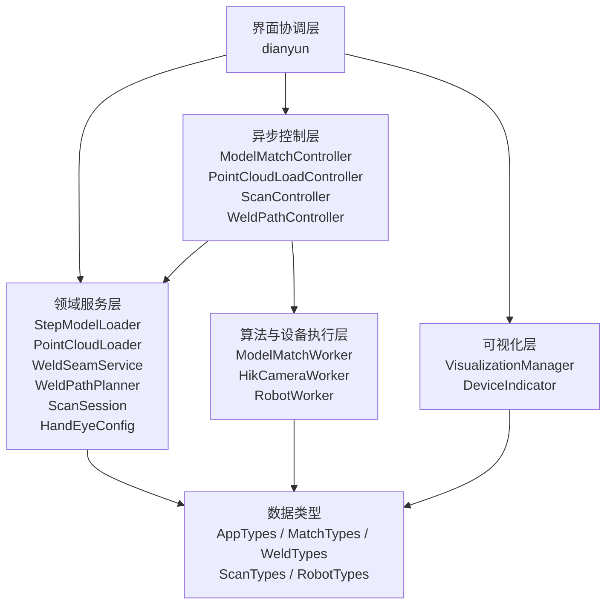
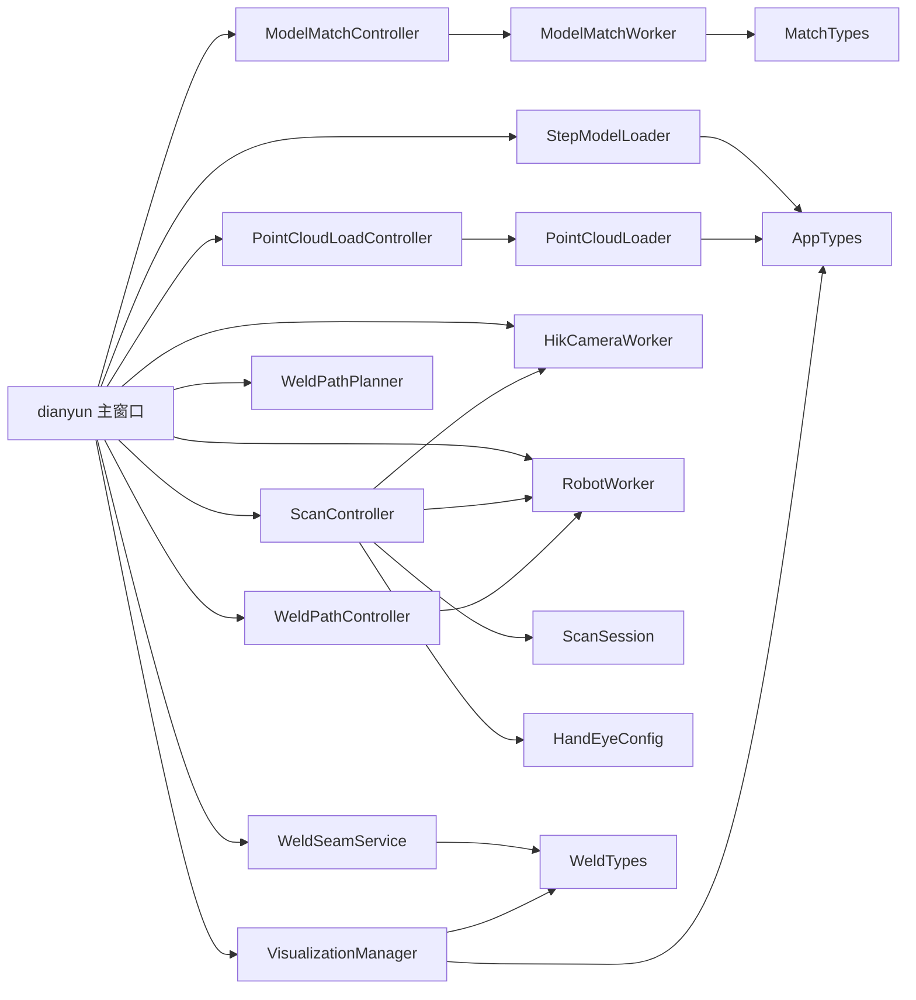

# 代码结构与模块职责

## 1. 仓库结构

```text
E:\data document\
├─ dianyun\
│  ├─ dianyun.sln
│  ├─ README.md
│  ├─ dianyun\
│  │  ├─ main.cpp
│  │  ├─ dianyun.h / dianyun.cpp / dianyun.ui
│  │  ├─ AppTypes.h
│  │  ├─ MatchTypes.h
│  │  ├─ WeldTypes.h
│  │  ├─ StepModelLoader.h / .cpp
│  │  ├─ PointCloudLoader.h / .cpp
│  │  ├─ PointCloudLoadController.h / .cpp
│  │  ├─ ModelMatchController.h / .cpp
│  │  ├─ ModelMatchWorker.h / .cpp
│  │  ├─ MatchRequestTracker.h
│  │  ├─ HikCameraWorker.h / .cpp
│  │  ├─ CameraCaptureState.h
│  │  ├─ ScanTypes.h
│  │  ├─ ScanSession.h / .cpp
│  │  ├─ ScanController.h / .cpp
│  │  ├─ RobotTypes.h
│  │  ├─ RobotWorker.h / .cpp
│  │  ├─ HandEyeConfig.h / .cpp
│  │  ├─ PoseMath.h
│  │  ├─ WeldPathPlanner.h / .cpp
│  │  ├─ WeldPathController.h / .cpp
│  │  ├─ DeviceIndicator.h / .cpp
│  │  ├─ QRoundLed.h / .cpp
│  │  ├─ WeldSeamService.h / .cpp
│  │  ├─ WeldSeamMapping.cpp
│  │  ├─ VisualizationManager.h / .cpp
│  │  ├─ resources\            图标（icons）与深色主题（theme/dark.qss）
│  │  ├─ dianyun.qrc
│  │  ├─ dianyun.vcxproj
│  │  └─ dianyun.vcxproj.filters
│  ├─ third_party\
│  │  ├─ mv3dlp\               海康 3D 线激光 SDK 头文件与 Mv3dLp.lib
│  │  └─ fairino-3.9.3\        法奥 SDK 头文件、fairino.lib / fairino.dll
│  └─ tests\
│     ├─ dianyun.tests.vcxproj
│     └─ WeldSeamMappingTests.cpp
└─ docs\
   ├─ delivery\                本交付文档
   ├─ calibration\             法奥工具坐标与相机手眼标定记录
   ├─ design\                  界面设计稿
   └─ superpowers\             界面重构的设计与实施计划
```

## 2. 总体分层



## 3. 文件职责

### 3.1 程序入口

#### `main.cpp`

职责：

- 初始化 Qt 应用；
- 设置 OpenGL SurfaceFormat；
- 创建并显示主窗口；
- 进入 Qt 事件循环。

不应放入：

- 点云算法；
- 文件读取；
- 相机业务逻辑；
- UI 状态判断。

### 3.2 主窗口协调

#### `dianyun.h`

定义：

- 主窗口类；
- Qt 槽函数；
- 当前 CAD、点云、匹配、焊缝和映射状态；
- 两个 PCL Viewer；
- 控制器、服务和可视化管理器；
- 焊缝选面状态机。

#### `dianyun.cpp`

职责：

- 连接 UI 事件和各模块；
- 初始化两个 QVTK/PCL 显示窗口；
- 调用 CAD/点云导入模块；
- 启动模型匹配、相机采集、扫描和轨迹执行；
- 构建菜单栏（文件、视图、通信、执行、帮助）及对应动作；
- 管理相机与机械臂的连接、状态指示灯和报警；
- 加载深色主题（`resources/theme/dark.qss`）；
- 接收异步结果；
- 管理按钮和菜单项可用性；
- 维护日志与状态栏；
- 维护焊缝列表、选面和起点设定流程；
- 保证输入替换后旧匹配结果失效。

注意：`dianyun.cpp` 体量已显著增长（较 7 月基线新增约 2000 行），新增业务应优先放入独立 Controller / Service。

关键函数：

| 函数 | 职责 |
| --- | --- |
| `initializeViewers()` | 创建 CAD 与点云两个 Viewer |
| `updateActionStates()` | 集中管理导入、拍摄、匹配、映射按钮 |
| `invalidateMatchResult()` | 使旧匹配和旧映射结果失效 |
| `on_btnOpen_clicked()` | 导入 STEP |
| `on_btnOpen_2_clicked()` | 启动点云后台导入 |
| `on_btnOpen_3_clicked()` | 启动模型匹配 |
| `on_btnOpenCamera_clicked()` | 启动相机采集 |
| `on_btnNewSeam_clicked()` | 进入焊缝选面状态 |
| `mouseEventOccurred()` | 通过 Ctrl+单击拾取 CAD 面 |
| `on_btnMapSeam_clicked()` | 映射当前选中焊缝 |
| `onMatchFinished()` | 保存、判定并显示匹配结果 |

维护要求：

- `dianyun.cpp` 只负责流程协调，不应继续堆积新的配准算法；
- 新增独立业务功能时，应优先创建 Service、Controller 或 Worker；
- 所有按钮状态修改应集中到 `updateActionStates()`。

### 3.3 数据类型

#### `AppTypes.h`

定义：

- `CloudRGB`：`pcl::PointCloud<pcl::PointXYZRGB>`；
- `CadModelData`：OpenCascade 形状、面列表、三角网格、面映射、CAD 采样点、尺寸；
- `CadModelData::isValid()`：统一 CAD 有效性判断。

#### `MatchTypes.h`

定义：

- `MatchConfig`：配准可调参数，包含 `scanUpAxis`（朝向相机的方向，默认 +Z，用于支撑平面判定）；
- `MatchVerdict`：`Pass`、`Fail`（`NeedsReview` 已移除）；
- `MatchResult`：最终矩阵、质量指标、诊断和判定。

最重要的坐标约定：

```text
MatchResult::T_final = CAD -> 扫描点云
```

扫描点云为基坐标点云时，`T_final` 即 CAD -> 机器人基坐标。

#### `WeldTypes.h`

定义：

- `WeldSeamSegment`：一个焊缝线段的起点和终点；
- `WeldSeamData`：焊缝 ID、名称、采样点、线段和长度。`points` / `segments` 的顺序即焊接方向，起点是第一个点。

#### `ScanTypes.h`

定义：

- `hostClockUs()`：进程内统一单调时钟（µs），相机回调与机器人遥测都用它打时间戳；
- `ScanFrame`：相机一批轮廓数据（`rows × cols` 的 X/Z 毫米值，空点为 NaN）；
- `ScanResult`：拼接后的深度图（x/y/z）；
- `CloudFrame`：`Sensor` 或 `RobotBase`，区分点云坐标系，只有 `RobotBase` 才能下发机械臂。

#### `RobotTypes.h`

定义 `RobotTelemetry`（机器人状态、急停、故障码、TCP 位姿、关节角、采样时刻）。刻意不引用 fairino SDK 类型，因为其 `robot_types.h` 会与 CRT 的 `errno_t` / `uint8_t` 冲突。

#### `PoseMath.h`

法奥固定轴 XYZ 位姿（mm / 度）与齐次矩阵互转。

### 3.4 CAD 导入

#### `StepModelLoader.h/.cpp`

职责：

- 读取 STEP；
- 检查实体；
- 计算模型对角线；
- 三角化；
- 生成显示网格；
- 建立三角单元到 CAD 面的映射；
- 按表面积采样 CAD 点云。

依赖：

- OpenCascade；
- PCL；
- Eigen。

输出：

- `CadModelData`。

### 3.5 点云导入

#### `PointCloudLoader.h/.cpp`

职责：

- 识别 PLY/PCD；
- 调用 PCL 文件读取；
- 删除非有限点和接近原点的无效点；
- 规范点云的 `width`、`height` 和 `is_dense`；
- 计算点云对角线。

该类是同步、无 UI 的纯读取器。

#### `PointCloudLoadController.h/.cpp`

职责：

- 使用 `QtConcurrent::run` 在后台调用 `PointCloudLoader`；
- 使用 `QFutureWatcher` 接收结果；
- 发送进度、成功、失败和忙碌状态；
- 析构时等待仍在运行的任务完成。

该类解决的是“文件读取阻塞主线程”，不负责点云显示。

### 3.6 模型匹配

#### `ModelMatchController.h/.cpp`

职责：

- 拥有独立 `QThread`；
- 将 `ModelMatchWorker` 移动到工作线程；
- 启动和停止线程；
- 传递只读 CAD/扫描点云共享指针；
- 为进度、处理中点云和最终结果附加请求编号；
- 向主窗口发送忙碌状态。

重要约束：

- 同一时间只运行一个匹配；
- 输入点云由主窗口替换智能指针，不在原对象上修改；
- Controller 不实现配准算法。

#### `ModelMatchWorker.h/.cpp`

职责：

- 完整模型匹配流水线；
- 预处理；
- 特征提取；
- 多来源粗配准；
- CAD 引导裁剪；
- 点到点 ICP；
- 点到面 ICP；
- 质量评估；
- 最终判定。

这是项目中算法最密集的文件。后续若继续扩大，应考虑拆为：

- `PointCloudPreprocessor`；
- `CoarseRegistrationService`；
- `FineRegistrationService`；
- `MatchQualityEvaluator`。

当前不建议在尚未建立更完整测试前立即拆分，因为这些阶段共享 `m_leafSize`、降采样点云、关键点和候选状态。

#### `MatchRequestTracker.h`

职责：

- 为匹配任务生成单调递增编号；
- 记录输入数据版本；
- 输入替换后使旧任务失效；
- 拒绝过期进度、预览点云和结果。

该类不启动线程，只解决异步结果归属问题。

### 3.7 相机采集

#### `HikCameraWorker.h/.cpp`

职责：

- 基于 Mv3dLp SDK 管理海康 3D 线激光相机，生命周期分 SDK / 设备 / 数据流 / 采集窗口四层；
- 连接、断开、起流、停流，状态机 `Disconnected / Connecting / Connected / Capturing / Fault`；
- 下发曝光、增益、步距、行率等参数，并回读 `LSLProfileCoordXUnit/ZUnit`；
- 在 SDK 回调线程中解码 `Profile/ABC16`，通过 Queued 信号送回 worker 线程；
- 单帧模式输出点云（`pointCloudReady`），扫描模式逐帧输出 `ScanFrame`（`scanFrameReady`）；
- 采集看门狗与线程互斥。

#### `CameraCaptureState.h`

职责：

- 使用 `std::atomic<bool>` 防止重复启动采集；
- 提供 `tryBegin()`、`finish()` 和 `isActive()`。

#### `ScanSession.h/.cpp`

职责：

- 把多批轮廓按全局行序号拼成整幅深度图，`Y = 行序号 × 步距`；
- 检测丢批并补空行，保持 Y 尺度；
- 轨迹模式：按每行采集时刻在机器人实测轨迹上插值得到 Y；
- 基坐标模式：`p_base = T_base_tcp(t) · tcpToSdk · (x, 0, z)`；
- 全部在 GUI 线程执行，无需加锁。

#### `ScanController.h/.cpp`

职责：扫描状态机 `Idle → Positioning → Starting → Scanning → Stopping → Done / Failed`，协调相机与机械臂；`ScanRequest` 定义行程、速度、起始位姿和相机几何。

#### `HandEyeConfig.h/.cpp`

职责：读写 exe 同目录的 `calibration.json`（工具 1 → 传感器外参、轴映射 `sensorAxis`、`timeOffsetUs`），文件不存在时写出默认模板。

### 3.7.1 机械臂

#### `RobotWorker.h/.cpp`

职责：

- 在独立线程中连接法奥控制器（默认 `192.168.58.2`），100 ms 轮询状态，判定链路与故障；
- 非阻塞下发 `MoveL / MoveCart`，由 50 ms 定时器轮询 `motion_done`；
- `stopMotion()` 立即停机；
- 通过 pimpl（`struct Impl`）隔离厂商头文件；
- Debug 配置未定义 `DIANYUN_ROBOT_SDK` 时为空实现。

#### `WeldPathPlanner.h/.cpp`

职责：纯几何，将基坐标有序焊缝折线转为 `WeldWaypoint` 序列（接近、下降、焊缝、退出、返回）。不访问机械臂，可单元测试。

#### `WeldPathController.h/.cpp`

职责：逐点下发 `MoveL`，每段等 `moveFinished` 后再发下一段，失败或取消即停机；发出 `progress / finished / failed` 信号。

#### `DeviceIndicator.h/.cpp`、`QRoundLed.h/.cpp`

职责：圆形状态指示灯。灰=未连接，灰闪=连接中，绿=已连接，绿闪=运动中，红=故障。

### 3.8 焊缝服务

#### `WeldSeamService.h`

公开两个领域操作：

- `createSeam()`；
- `mapSeam()`。

#### `WeldSeamService.cpp`

职责：

- 根据两个 OpenCascade 面计算交线；
- 按曲线长度确定采样数；
- 生成采样点、连续线段和总长度。

#### `WeldSeamMapping.cpp`

职责：

- 验证输入矩阵是合法刚性变换；
- 将 CAD 焊缝点和线段转换到扫描坐标系；
- 保持焊缝元数据和拓扑数量；
- 按起点与方向重排焊缝链（设定起点、反转方向），映射因此继承方向。

映射代码与 CAD 面求交代码分离，便于无 OpenCascade 几何计算的单元测试。

### 3.9 可视化

#### `VisualizationManager.h/.cpp`

职责：

- 管理两个 PCL Viewer；
- 显示 CAD 网格；
- 渐进显示完整点云；
- 显示处理后工件点云；
- 显示半透明对齐 CAD；
- 高亮 CAD 面；
- 将焊缝线段拼成连续折线；
- 使用 VTK TubeFilter 将焊缝显示为三维管道；
- 同步 CAD 和点云视图的焊缝选中颜色；
- 绘制焊缝起点球标（青色）与走向箭头。

关键显示参数：

- 点云批次：100000 点；
- 处理后点云点大小：3；
- 对齐 CAD 透明度：0.5；
- 焊缝管道半径：显示尺度的 0.25%；
- 管道圆周边数：12。

所有 PCL/VTK actor ID 由该类统一管理，不应由主窗口拼接字符串直接操作。

### 3.10 UI 文件

#### `dianyun.ui`

Qt Designer 布局（深色工业风，样式由 `resources/theme/dark.qss` 提供），主要控件：

- `btnOpen`：导入三维模型；
- `btnOpen_2`：导入点云模型；
- `btnOpen_3`：模型匹配；
- `btnOpenCamera`：开始拍摄；
- 机械臂焊接、视图复位按钮；
- `btnNewSeam`：新建焊缝；
- 设定起点、反转方向按钮；
- `btnMapSeam`：焊缝映射；
- `btnCancel`：取消操作；
- `btnDeleteSeam`：删除选中；
- `listWeldSeams`：焊缝列表；
- 匹配指标与数据概况面板；
- 报警条与“解除报警”；
- `textLog`：操作日志；
- `widget`、`widget_2`：两个三维视图容器。

菜单栏由 `dianyun.cpp` 以代码方式创建，不在 `.ui` 中。控件名以 `.ui` 文件为准。

### 3.11 测试工程

#### `tests/WeldSeamMappingTests.cpp`

`main()` 依次运行：焊缝映射与请求状态检查、`checkScanSession()`、`checkPoseMath()`、`checkWeldPathPlanner()`，全部通过后输出 `WeldSeamMappingTests passed`。

覆盖：

- 相机采集状态不允许重入；
- 采集结束后状态可重置；
- 匹配请求完成后不再接受；
- 输入替换后旧请求不再接受；
- 请求编号单调递增；
- 正确刚性焊缝映射；
- 非齐次矩阵拒绝；
- 镜像矩阵拒绝；
- 缩放矩阵拒绝；
- 空焊缝拒绝；
- 非有限焊缝点拒绝；
- 扫描拼接：行序号补 Y、丢批补空行、轨迹模式与基坐标输出；
- 位姿换算（固定轴 XYZ 与齐次矩阵互转）；
- 焊缝轨迹规划：接近/下降/焊缝/退出路点、点合并与共线删除、返回段与 `seamEnd()`。

#### `tests/dianyun.tests.vcxproj`

独立控制台测试工程，不依赖物理相机和机械臂。

## 4. 主要依赖方向



## 5. 新功能应放在哪里

| 新需求 | 推荐位置 |
| --- | --- |
| 新点云文件格式 | `PointCloudLoader` |
| 新 CAD 格式 | 新建与 `StepModelLoader` 同级 Loader |
| 新预处理算法 | `ModelMatchWorker`，成熟后拆为 Preprocessor |
| 新粗配准算法 | `ModelMatchWorker::coarseRegistration()` |
| 新质量指标 | `MatchResult` + 评价函数 + `classifyResult()` |
| 配准矩阵导出 | 新建结果导出 Service，由主窗口调用 |
| 焊缝最近点吸附 | 新建独立 `WeldSeamProjectionService`，不要修改刚性映射语义 |
| 焊缝轨迹几何（姿态、路点） | `WeldPathPlanner`，保持纯几何、不访问机械臂 |
| 新机械臂指令 | `RobotWorker`，厂商头文件只能出现在 `RobotWorker.cpp` |
| 新扫描方式或拼接策略 | `ScanSession` / `ScanController` |
| 手眼标定参数 | `HandEyeConfig` 与 `calibration.json` |
| 新菜单项 | `dianyun.cpp` 的菜单构建处，并在 `updateActionStates()` 中管理可用性 |
| 新三维 actor | `VisualizationManager` |
| 新后台任务 | 新建 Controller/Worker，避免在主线程计算 |
| 新按钮状态条件 | `dianyun::updateActionStates()` |

## 6. 维护注意事项

1. 不要在匹配线程运行期间原地修改输入点云。
2. 不要绕过 `MatchRequestTracker` 直接接受异步结果。
3. 不要把 `T_final` 当成扫描到 CAD 的矩阵。
4. 不要在相机 SDK 回调中直接操作 UI。
5. 不要从多个线程同时修改 PCL Visualizer。
6. 不要把焊缝映射和焊缝吸附混为一个函数。
7. 不要在多个槽函数中分别设置同一按钮状态。
8. 修改判定阈值时同步更新参数文档和测试报告。
9. 不要在 `RobotWorker.cpp` 之外包含法奥 SDK 头文件。
10. 扫描中任何失败路径都必须同时停机和停止采集，避免激光常亮。
11. 非 `RobotBase` 点云上的匹配和映射结果不得用于生成机械臂轨迹。

