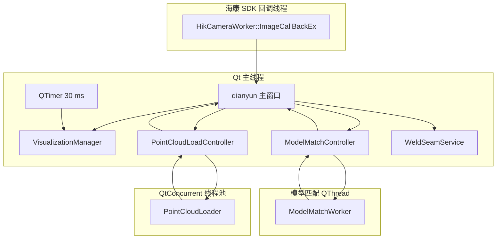
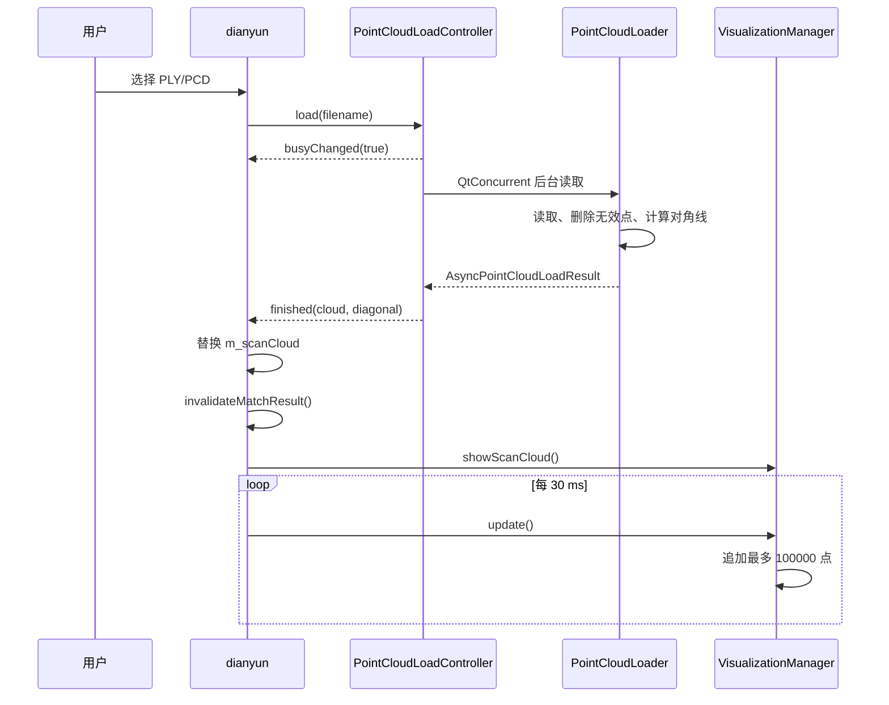
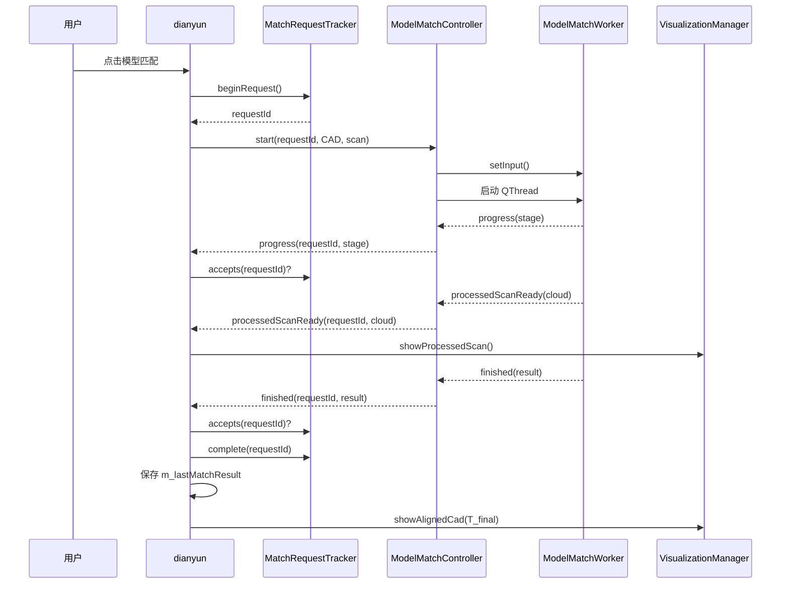
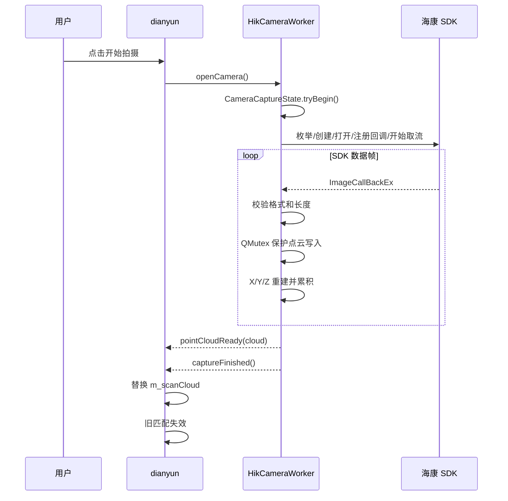
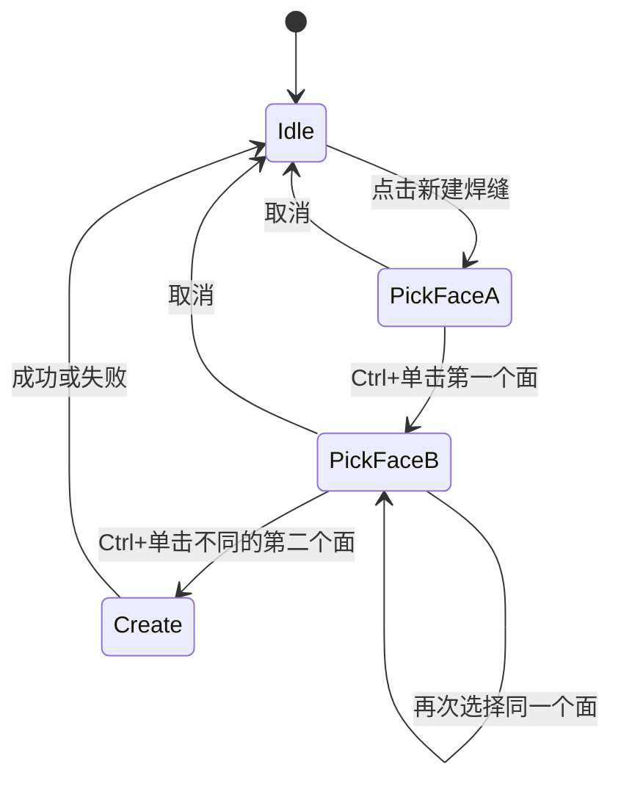
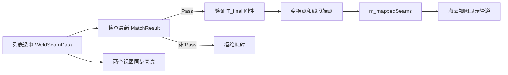
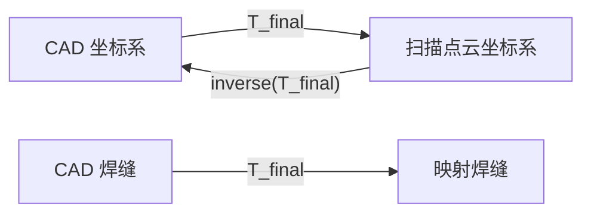

# 系统架构与数据流程

## 1. 架构目标

当前架构重点解决：

- 大点云读取不阻塞 UI；
- 模型匹配不阻塞 UI；
- 相机 SDK 回调与 UI 解耦；
- 输入替换后旧异步结果不能污染新状态；
- 三维渲染集中管理；
- 焊缝创建、映射和显示职责分离。

## 2. 运行时组件



## 3. 主线程职责

主线程负责：

- Qt UI；
- 文件选择对话框；
- 控制器启动；
- 日志；
- 状态栏；
- PCL/VTK actor 操作；
- 焊缝列表；
- 接收异步信号；
- 数据对象替换。

主线程不应执行：

- 大点云文件同步读取；
- 完整模型匹配；
- 相机回调点循环；
- 长时间最近邻搜索。

## 4. 点云导入数据流



重要数据所有权：

- `CloudRGB::Ptr` 使用共享指针；
- Loader 创建完整点云；
- 主窗口保存为 `m_scanCloud`；
- VisualizationManager 在渐进显示期间保存同一共享指针；
- 不为显示复制全部点，每批仅复制当前块。

## 5. 模型匹配数据流



## 6. 过期结果保护

问题场景：

1. 匹配任务使用 CAD A 和点云 A 启动；
2. 在任务返回前输入被替换为 CAD B 或点云 B；
3. 旧任务返回矩阵；
4. 若不检查，旧矩阵可能被用于新数据和新焊缝。

解决方式：

- `MatchRequestTracker` 维护 `dataRevision`；
- 每次 CAD 或点云替换调用 `invalidateData()`；
- 每个任务获得新的 `requestId`；
- 主窗口只接受当前 ID 且数据版本一致的信号；
- 任务完成后 ID 失效。

当前 UI 同时禁用运行中的导入和拍摄，版本检查构成第二层保护。

## 7. 相机数据流



相机回调不直接操作 UI。

## 8. 焊缝创建数据流



数据链：

```text
VTK 三角单元 ID
  -> cellToFaceMap
  -> OpenCascade Face ID
  -> TopoDS_Face
  -> BRepAlgoAPI_Section
  -> WeldSeamData
  -> VisualizationManager 三维管道
```

## 9. 焊缝映射数据流



## 10. 状态和按钮管理

`updateActionStates()` 统一计算：

```text
matchRunning
cloudLoading
cameraCapturing
dataActionsEnabled
```

按钮规则：

| 按钮 | 启用条件 |
| --- | --- |
| 导入 CAD | 没有匹配、加载或采集 |
| 导入点云 | 没有匹配、加载或采集 |
| 开始拍摄 | 没有匹配、加载或采集 |
| 模型匹配 | 数据操作可用、点云已显示完、CAD 有效、点云非空 |
| 焊缝映射 | 数据操作可用、选中焊缝、最新匹配成功且 `Pass` |

后续新增状态时，应扩展该函数，而不是在多个槽函数散落 `setEnabled()`。

## 11. 数据生命周期

### CAD

```text
导入 -> CadModelData -> 显示/选面/匹配
重新导入 -> 清空旧焊缝、旧匹配、旧映射
```

### 扫描点云

```text
文件或相机 -> m_scanCloud -> 渐进显示 -> 匹配
重新导入/采集 -> 旧匹配和旧映射失效
```

### 匹配结果

```text
任务启动 -> requestId
任务返回 -> 校验 requestId
有效 -> m_lastMatchResult
输入替换 -> 重置
```

### 焊缝

```text
CAD 选面 -> m_seams
列表选中 -> 两视图高亮
Pass 匹配 -> m_mappedSeams
删除 -> 两坐标系 actor 同步删除
```

## 12. 坐标关系



相机点云坐标由当前实现定义为：

```text
x = (rawX - width/2) * xRes
y = frameIndex * yRes
z = rawZ / zScale
```

这只是相机局部坐标，不等于机器人、工位或世界坐标。

## 13. 错误传播

模块通过以下方式报告错误：

| 模块 | 错误通道 |
| --- | --- |
| Loader/Service | `bool` + `QString errorMessage` |
| PointCloudLoadController | `failed(QString)` |
| ModelMatchWorker | `MatchResult.errorMessage` |
| HikCameraWorker | `lastError()` + `captureFailed(QString)` |
| 主窗口 | 时间戳日志和状态栏 |

原则：

- 算法和服务不弹 UI 对话框；
- 主窗口决定如何向用户呈现；
- 未知异常在 Worker 边界捕获；
- 失败结果不能继续焊缝映射。

## 14. 线程安全边界

### 已保护

- 点云文件读取在独立任务中；
- 模型匹配在独立 QThread；
- 相机累积点云和帧计数使用 QMutex；
- 相机启动状态使用原子变量；
- PCL Viewer 只在主线程调用；
- 匹配输入以只读共享指针传递；
- 旧异步结果使用请求 ID 拒绝。

### 仍需注意

- `ModelMatchController` 析构时调用 `quit()` 不会强制中断正在执行的 CPU 算法，只会等待其返回；
- 当前没有用户取消匹配机制；
- 相机参数为公共成员，运行时不应在回调期间修改；
- 新增共享数据时必须明确线程归属。

