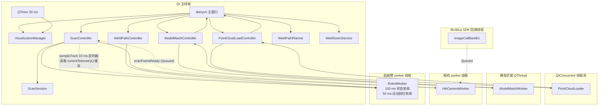
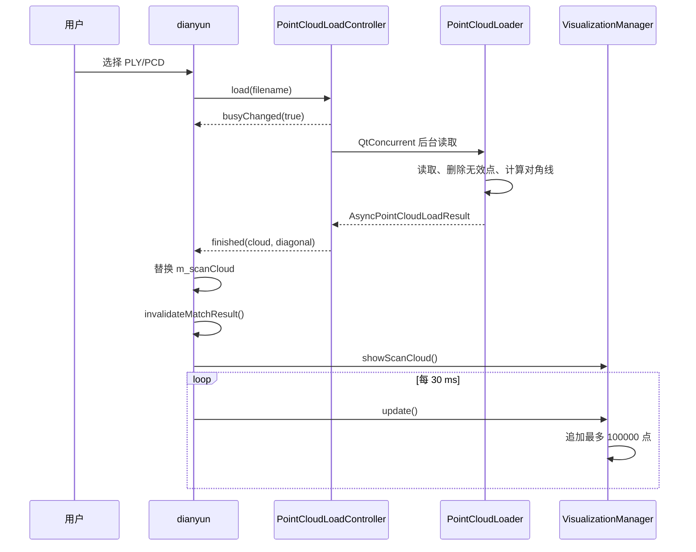
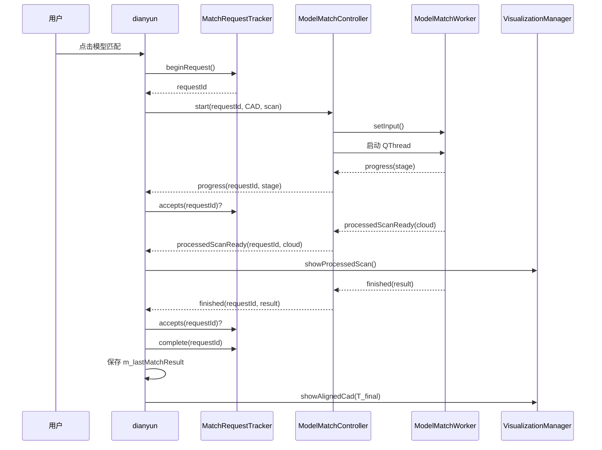
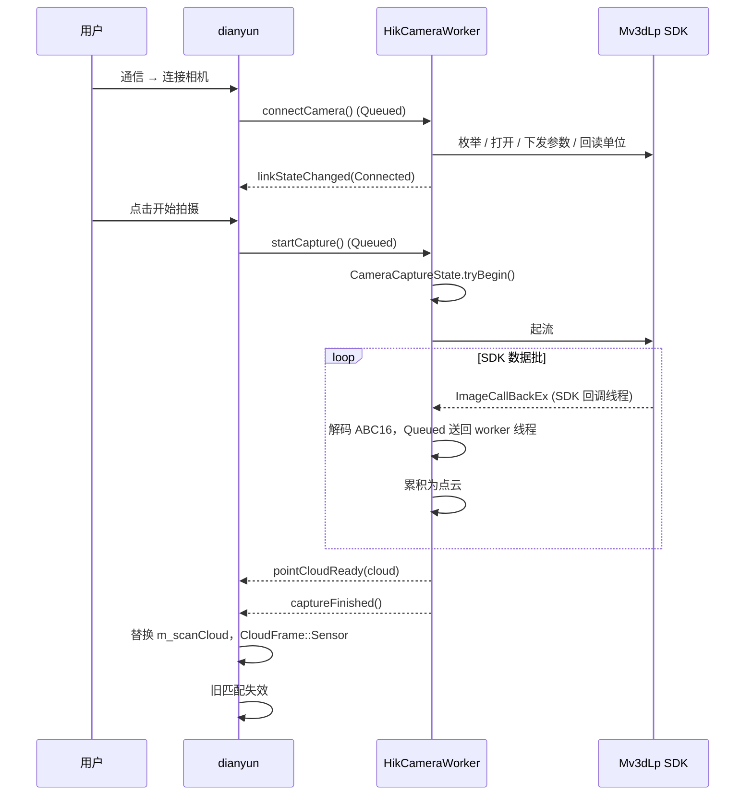
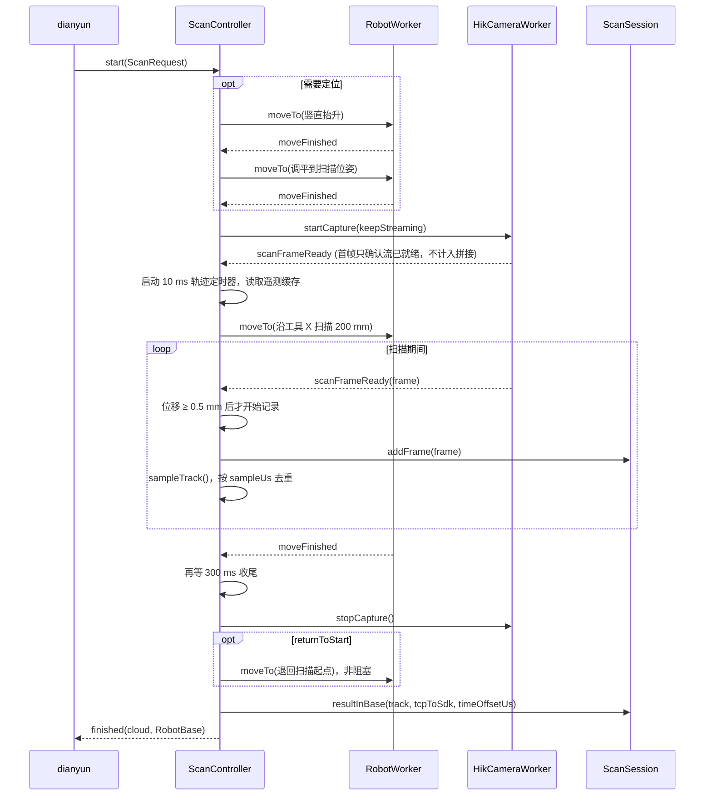
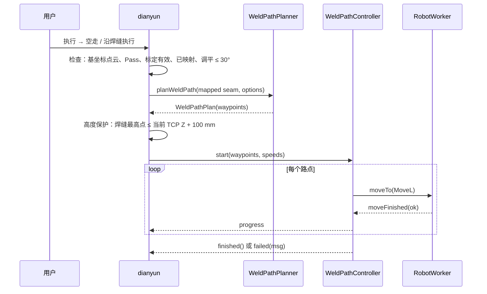
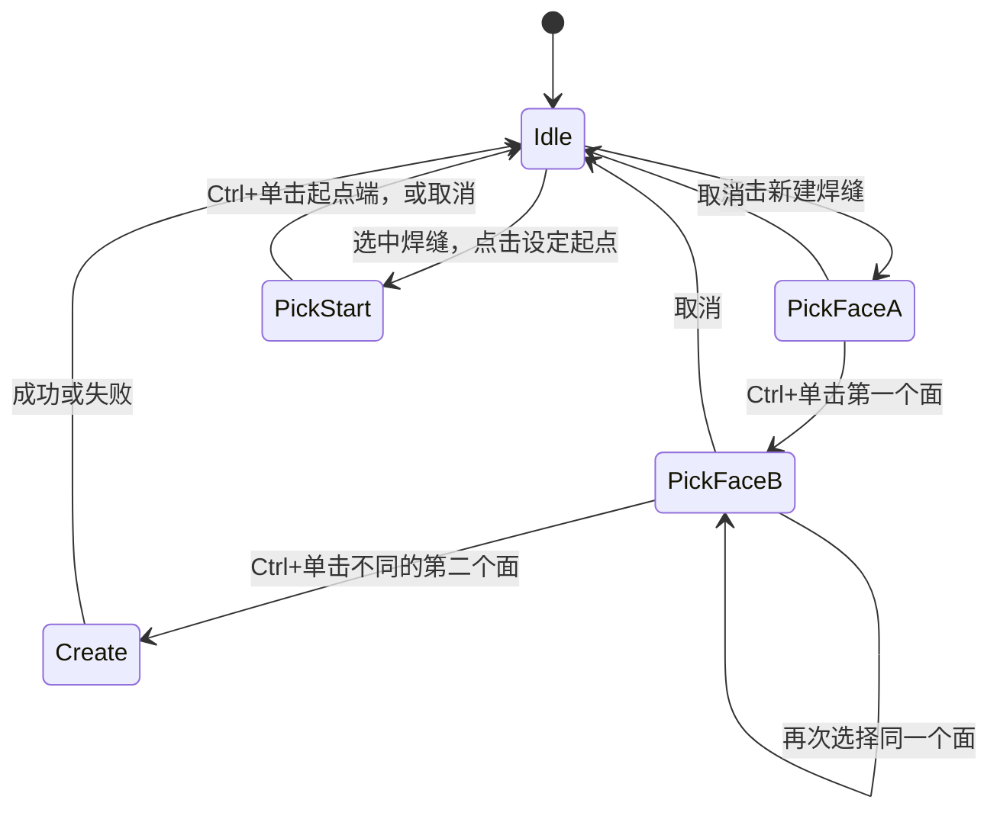
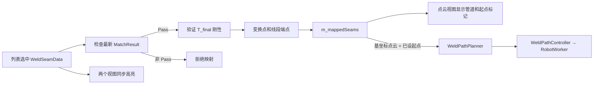
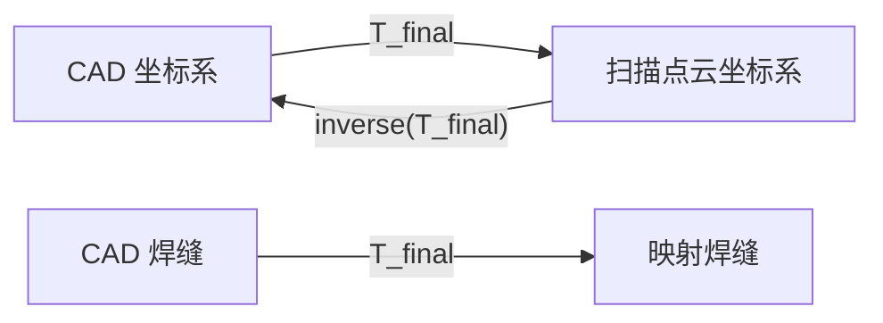

# 系统架构与数据流程

## 1. 架构目标

当前架构重点解决：

- 大点云读取不阻塞 UI；
- 模型匹配不阻塞 UI；
- 相机 SDK 回调、机械臂 RPC 与 UI 解耦；
- 相机与机械臂用同一时钟打时间戳，使扫描行能对齐到机器人轨迹；
- 输入替换后旧异步结果不能污染新状态；
- 三维渲染集中管理；
- 焊缝创建、映射、轨迹规划和显示职责分离；
- 任何失败路径都能同时停机和停流。

## 2. 运行时组件



## 3. 主线程职责

主线程负责：

- Qt UI；
- 文件选择对话框；
- 控制器启动；
- 日志；
- 状态栏；
- PCL/VTK actor 操作；
- 焊缝列表；
- 接收异步信号；
- 数据对象替换；
- 扫描状态机与轮廓拼接（`ScanController`、`ScanSession`，无需加锁）；
- 轨迹规划与逐段下发（`WeldPathController`）。

主线程不应执行：

- 大点云文件同步读取；
- 完整模型匹配；
- 相机回调点循环；
- 机械臂 RPC 调用；
- 长时间最近邻搜索。

## 4. 点云导入数据流



重要数据所有权：

- `CloudRGB::Ptr` 使用共享指针；
- Loader 创建完整点云；
- 主窗口保存为 `m_scanCloud`；
- VisualizationManager 在渐进显示期间保存同一共享指针；
- 不为显示复制全部点，每批仅复制当前块。

## 5. 模型匹配数据流



## 6. 过期结果保护

问题场景：

1. 匹配任务使用 CAD A 和点云 A 启动；
2. 在任务返回前输入被替换为 CAD B 或点云 B；
3. 旧任务返回矩阵；
4. 若不检查，旧矩阵可能被用于新数据和新焊缝。

解决方式：

- `MatchRequestTracker` 维护 `dataRevision`；
- 每次 CAD 或点云替换调用 `invalidateData()`；
- 每个任务获得新的 `requestId`；
- 主窗口只接受当前 ID 且数据版本一致的信号；
- 任务完成后 ID 失效。

当前 UI 同时禁用运行中的导入和拍摄，版本检查构成第二层保护。

## 7. 相机数据流

### 7.1 单帧拍摄



相机回调不直接操作 UI；回调只做解码，并通过 `internalCaptureDone / internalScanFrame / internalCaptureError` 以 Queued 方式送回 worker 线程。采集看门狗按帧数与行率推算超时。

### 7.2 机械臂扫描



要点：

- 相机在定位完成之后、扫描运动之前起流，到位后再等 300 ms 才停流，保证行程两端都有数据；
- 退回起点在停流后发出，拼接与退回并行，不会污染数据；
- 有效手眼标定且轨迹样本充足时输出 `CloudFrame::RobotBase`；否则回退为 `CloudFrame::Sensor`（轨迹拼接或名义行序号拼接）；
- 拼接前复核帧号跳变：若实收行率已达设定行率的 80%，认为不是真丢批，补齐区间作废；
- 相机断线（`Disconnected` 或 `Fault`）立即判扫描失败；
- 任何失败路径都同时 `stopMotion()` 与停止采集；
- 看门狗覆盖定位超时（60 s）、起流等待（2 s）、扫描运动超时和收尾（300 ms）。

## 7.3 机械臂状态数据流

`RobotWorker` 在独立线程中每 100 ms 轮询状态，发出 `telemetryUpdated`；运动期间另有 50 ms 定时器轮询 `motion_done`，到位后发 `moveFinished(ok, error)`。主窗口据此刷新状态指示灯、报警条和菜单可用性。

链路故障判据：连续 5 次轮询失败，或 20004 状态流帧序号停止推进超过 1 s。

## 7.4 焊缝轨迹执行数据流



失败或取消即停机，不自动返回。

## 8. 焊缝创建数据流



数据链：

```text
VTK 三角单元 ID
  -> cellToFaceMap
  -> OpenCascade Face ID
  -> TopoDS_Face
  -> BRepAlgoAPI_Section
  -> WeldSeamData
  -> VisualizationManager 三维管道
```

起点与方向：`WeldSeamData` 的 `points` / `segments` 顺序就是焊接方向。设定起点按连通链重排并反转；反转方向整体倒序。已映射的焊缝在方向改变后，用当前匹配变换重建映射，因此映射、轨迹和显示总是一致。

## 9. 焊缝映射数据流



## 10. 状态和按钮管理

`updateActionStates()` 统一计算：

```text
matchRunning
cloudLoading
cameraCapturing
scanning
pathRunning
scanPossible      相机与机械臂都在线，没有匹配、加载
motionPossible    机械臂在线、手眼标定有效、点云为 RobotBase、没有扫描/轨迹/匹配
seamReady         motionPossible、已选焊缝、最新匹配成功且 Pass
seamStartReady    seamReady、焊缝已设起点且已映射
dataActionsEnabled
```

按钮和菜单规则：

| 控件 | 启用条件 |
| --- | --- |
| 导入 CAD | 没有匹配、加载或采集 |
| 导入点云 | 没有匹配、加载或采集 |
| 开始拍摄 | 没有匹配、加载或采集 |
| 模型匹配 | 数据操作可用、点云已显示完、CAD 有效、点云非空 |
| 焊缝映射 | 数据操作可用、选中焊缝、最新匹配成功且 `Pass` |
| 执行 → 开始扫描采集 | `scanPossible`，且没有扫描、轨迹在运行 |
| 执行 → 取消扫描 | 正在扫描 |
| 执行 → 移动至焊缝起点上方 | `seamStartReady` |
| 执行 → 焊缝空走 / 沿焊缝执行 | `seamReady` |
| 执行 → 停止轨迹运动 | 轨迹运行中 |
| 通信 → 重新加载手眼标定 | 没有扫描、轨迹在运行 |

后续新增状态时，应扩展该函数，而不是在多个槽函数散落 `setEnabled()`。

## 11. 数据生命周期

### CAD

```text
导入 -> CadModelData -> 显示/选面/匹配
重新导入 -> 清空旧焊缝、旧匹配、旧映射
```

### 扫描点云

```text
文件、单帧拍摄 -> m_scanCloud (Sensor) -> 渐进显示 -> 匹配
机械臂扫描 -> m_scanCloud (RobotBase) -> 渐进显示 -> 匹配
重新导入/采集 -> 旧匹配和旧映射失效
```

`m_scanCloudFrame` 记录当前点云的坐标系；只有 `RobotBase` 才允许下发机械臂。

### 匹配结果

```text
任务启动 -> requestId
任务返回 -> 校验 requestId
有效 -> m_lastMatchResult
输入替换 -> 重置
```

### 焊缝

```text
CAD 选面 -> m_seams
设定起点 / 反转方向 -> 重排 points/segments
列表选中 -> 两视图高亮
Pass 匹配 -> m_mappedSeams
删除 -> 两坐标系 actor 同步删除
```

## 12. 坐标关系



两种扫描点云坐标系：

| `CloudFrame` | 来源 | 坐标 | `T_final` | 能否驱动机械臂 |
| --- | --- | --- | --- | --- |
| `Sensor` | 文件导入、单帧拍摄、轨迹不足时的回退拼接 | 传感器局部坐标 | CAD → 传感器 | 否 |
| `RobotBase` | 机械臂扫描且手眼标定有效 | 机器人基坐标（mm） | CAD → 基坐标 | 是 |

基坐标点云由下式得到：

```text
p_base = T_base_tcp(t) · T_tcp_sensor · M_axis · (x, 0, z)_SDK
```

详见 [04-算法详细说明](04-算法详细说明.md) 第 21 节。传感器坐标不等于机器人、工位或世界坐标。

## 13. 错误传播

模块通过以下方式报告错误：

| 模块 | 错误通道 |
| --- | --- |
| Loader/Service | `bool` + `QString errorMessage` |
| PointCloudLoadController | `failed(QString)` |
| ModelMatchWorker | `MatchResult.errorMessage` |
| HikCameraWorker | `lastError()` + `captureFailed(QString)` + `linkStateChanged` |
| RobotWorker | `lastError()` + `faultRaised(QString)` + `moveFinished(false, error)` |
| ScanController | `failed(QString)` |
| WeldPathController | `failed(QString)` |
| WeldPathPlanner | `bool` + `QString errorMessage` |
| 主窗口 | 时间戳日志、状态栏和报警条 |

原则：

- 算法和服务不弹 UI 对话框；
- 主窗口决定如何向用户呈现；
- 未知异常在 Worker 边界捕获；SDK 抛出的异常（如法奥 XML-RPC 解析异常）在 `RobotWorker` 内部 `try/catch`，上报错误而非闪退；
- 失败结果不能继续焊缝映射；
- 扫描或轨迹失败必须停机。

## 14. 线程安全边界

### 已保护

- 点云文件读取在独立任务中；
- 模型匹配在独立 QThread；
- 相机和机械臂各自运行在独立 QThread，主线程通过 `QMetaObject::invokeMethod` 以 Queued 方式调用其槽；
- 相机 SDK 回调只做解码，经 Queued 信号送回 worker 线程；
- 相机累积点云和帧计数使用 QMutex；
- 相机启动状态使用原子变量；回调读取的单位换算系数使用 `std::atomic<float>`；
- 机械臂状态使用 `std::atomic<State>`，遥测缓存由 `QMutex` 保护，`ScanController` 通过 `currentTelemetry()` 读取；
- 相机回调与机器人遥测使用同一个 `hostClockUs()` 单调时钟；
- 法奥 SDK 头文件隔离在 `RobotWorker.cpp` 内（pimpl）；
- PCL Viewer 只在主线程调用；
- 匹配输入以只读共享指针传递；
- 旧异步结果使用请求 ID 拒绝。

### 仍需注意

- `ModelMatchController` 析构时调用 `quit()` 不会强制中断正在执行的 CPU 算法，只会等待其返回；
- 当前没有用户取消匹配机制；
- 相机参数为公共成员，运行时不应在回调期间修改；
- `RobotWorker` 的 `m_ip` 和 `m_pollIntervalMs` 是公共成员，应只在连接前修改；
- `ScanController` 和 `ScanSession` 假定都在 GUI 线程使用，不加锁；
- 部分相机 / 机械臂调用使用 `BlockingQueuedConnection`，在 worker 线程阻塞时可能卡住主线程；
- 新增共享数据时必须明确线程归属。

