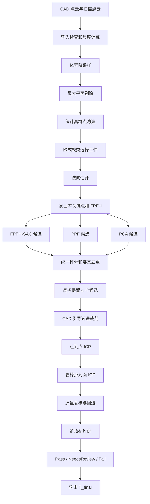

# 模型匹配算法原理与实现详解

## 1. 文档目的与阅读方式

本文档说明本项目“CAD 三维模型与实拍点云自动匹配”功能中的算法原理、数学公式、采用原因、工程用法、参数和故障判断。

本文档按照当前代码实际执行顺序编写，主要对应：

- `dianyun/dianyun/ModelMatchWorker.cpp`
- `dianyun/dianyun/ModelMatchWorker.h`
- `dianyun/dianyun/ModelMatchController.cpp`
- `dianyun/dianyun/ModelMatchController.h`
- `dianyun/dianyun/MatchTypes.h`
- `dianyun/dianyun/dianyun.cpp`

公式使用 VS Code Markdown 预览支持的 KaTeX 语法：

- 行内公式：`$x^2$`
- 独立公式：`$$...$$`
- Windows/Linux 使用 `Ctrl+Shift+V` 打开预览。

若阅读器不支持公式渲染，可查看同目录中的：

`11A-模型匹配算法原理与实现详解-纯文本兼容版.md`

---

## 2. 模型匹配问题

### 2.1 输入数据

模型匹配使用两组带法向点云。

CAD 点云：

$$
\mathcal{C}
=
\left\{
\left(\mathbf{c}_j,\mathbf{n}^{c}_j\right)
\right\}_{j=1}^{N_c}
$$

扫描点云：

$$
\mathcal{S}
=
\left\{
\left(\mathbf{s}_i,\mathbf{n}^{s}_i\right)
\right\}_{i=1}^{N_s}
$$

其中：

- $\mathbf{c}_j\in\mathbb{R}^3$：第 $j$ 个 CAD 点坐标。
- $\mathbf{s}_i\in\mathbb{R}^3$：第 $i$ 个扫描点坐标。
- $\mathbf{n}^{c}_j$：CAD 点单位法向。
- $\mathbf{n}^{s}_i$：扫描点单位法向。
- $N_c$、$N_s$：两组点云的点数。

CAD 点云由 STEP 表面采样得到；扫描点云来自 PLY、PCD 或相机采集结果。

### 2.2 刚体变换

目标是求一个刚体变换：

$$
\mathbf{T}
=
\begin{bmatrix}
\mathbf{R} & \mathbf{t}\\
\mathbf{0}^{T} & 1
\end{bmatrix}
\in SE(3)
$$

其中：

- $\mathbf{R}\in SO(3)$：$3\times3$ 旋转矩阵。
- $\mathbf{t}\in\mathbb{R}^3$：平移向量。

点的变换为：

$$
\mathbf{p}'
=
\mathbf{R}\mathbf{p}+\mathbf{t}
$$

使用齐次坐标时：

$$
\begin{bmatrix}
\mathbf{p}'\\
1
\end{bmatrix}
=
\mathbf{T}
\begin{bmatrix}
\mathbf{p}\\
1
\end{bmatrix}
$$

### 2.3 变换方向

算法内部主要计算扫描到 CAD 的变换：

$$
\mathbf{p}_{cad}
=
\mathbf{T}_{S\rightarrow C}
\mathbf{p}_{scan}
$$

最终返回的 `MatchResult::T_final` 是其逆矩阵：

$$
\mathbf{T}_{final}
=
\mathbf{T}_{C\rightarrow S}
=
\mathbf{T}_{S\rightarrow C}^{-1}
$$

因此，CAD 焊缝点映射到扫描坐标系应使用：

$$
\mathbf{p}^{seam}_{scan}
=
\mathbf{T}_{final}
\mathbf{p}^{seam}_{cad}
$$

法向或方向向量只使用旋转部分：

$$
\mathbf{n}_{scan}
=
\mathbf{R}_{final}\mathbf{n}_{cad}
$$

### 2.4 刚体合法性

正确旋转矩阵满足：

$$
\mathbf{R}^{T}\mathbf{R}
=
\mathbf{I}
$$

并且：

$$
\det(\mathbf{R})=+1
$$

若 $\det(\mathbf{R})=-1$，变换包含镜像反射。当前程序拒绝这种候选。

当前匹配不允许：

- 缩放；
- 镜像；
- 剪切；
- 非刚性形变。

这是因为同一刚性工件的 CAD 与扫描应具有相同尺度。尺度错误应在单位换算或相机标定层修正。

---

## 3. 完整算法流程



多阶段设计主要用于应对：

- 扫描点云不完整；
- 底板、工作台和夹具干扰；
- 深度相机飞点；
- 工件重复结构或对称结构；
- 单个粗配准算法随机失败；
- ICP 收敛到错误局部最优。

---

## 4. CAD 尺度和体素尺寸

### 4.1 包围盒对角线

设 CAD 轴对齐包围盒的最小点和最大点为：

$$
\mathbf{c}_{min}
=
\begin{bmatrix}
x_{min}&y_{min}&z_{min}
\end{bmatrix}^{T}
$$

$$
\mathbf{c}_{max}
=
\begin{bmatrix}
x_{max}&y_{max}&z_{max}
\end{bmatrix}^{T}
$$

CAD 对角线为：

$$
D_{cad}
=
\left\|
\mathbf{c}_{max}-\mathbf{c}_{min}
\right\|_2
$$

展开后：

$$
D_{cad}
=
\sqrt{
(x_{max}-x_{min})^2
+(y_{max}-y_{min})^2
+(z_{max}-z_{min})^2
}
$$

### 4.2 动态体素尺寸

当前代码使用：

$$
L
=
\max
\left(
D_{cad}f_{leaf},
0.5
\right)
$$

其中：

- $L$：`m_leafSize`。
- $f_{leaf}$：`MatchConfig::leafSizeFactor`。
- 默认 $f_{leaf}=0.01$。

例如 $D_{cad}=200\text{ mm}$：

$$
L
=
\max(200\times0.01,0.5)
=
2\text{ mm}
$$

### 4.3 为什么使用相对尺度

大量阈值使用 $L$ 的倍数：

| 用途 | 当前值 |
|---|---:|
| 平面距离阈值 | $1.25L$ |
| 聚类连接距离 | $2L$ |
| 法向搜索半径 | $3L$ |
| 主曲率搜索半径 | $4L$ |
| FPFH 搜索半径 | $6L$ |
| 粗配准最大对应距离 | $4L$ |
| 点到点 ICP 对应距离 | $3L$ |
| 点到面 ICP 对应距离 | $2L$ |
| 最终评价距离 | $2.5L$ |

这种设计使参数能随工件尺寸缩放。

前提是 CAD 与扫描必须使用相同单位。

---

## 5. 体素降采样

### 5.1 原理

三维空间被划分为边长 $L$ 的立方体体素：

$$
V_{a,b,c}
=
[aL,(a+1)L)
\times
[bL,(b+1)L)
\times
[cL,(c+1)L)
$$

落入同一体素的点集为：

$$
\mathcal{P}_{a,b,c}
=
\left\{
\mathbf{p}_k
\mid
\mathbf{p}_k\in V_{a,b,c}
\right\}
$$

用质心代表该体素：

$$
\bar{\mathbf{p}}_{a,b,c}
=
\frac{1}
{|\mathcal{P}_{a,b,c}|}
\sum_{\mathbf{p}_k\in\mathcal{P}_{a,b,c}}
\mathbf{p}_k
$$

### 5.2 当前用法

CAD 和扫描均先执行：

```cpp
grid.setLeafSize(m_leafSize, m_leafSize, m_leafSize);
```

### 5.3 为什么使用

原始扫描可能包含数百万点。若直接计算法向、FPFH 和 ICP：

- 运行时间长；
- 内存占用高；
- 高密度区域权重过大；
- 相机采样纹理会干扰几何。

体素降采样保留整体形状，同时将后续计算规模降到可控范围。

### 5.4 参数影响

`leafSizeFactor` 太小：

- 点数多、速度慢；
- 噪声保留较多；
- 法向更容易抖动。

`leafSizeFactor` 太大：

- 小孔、窄槽、棱边被平滑；
- 特征数量下降；
- 配准精度上限下降。

---

## 6. RANSAC 最大平面剔除

### 6.1 平面模型

平面方程：

$$
ax+by+cz+d=0
$$

点 $\mathbf{p}=(x,y,z)^T$ 到平面的距离：

$$
d(\mathbf{p},\Pi)
=
\frac{
|ax+by+cz+d|
}{
\sqrt{a^2+b^2+c^2}
}
$$

### 6.2 RANSAC 原理

每轮随机选择 3 个点拟合平面，并统计满足以下条件的内点：

$$
d(\mathbf{p},\Pi)<\tau_{plane}
$$

若内点比例为 $w$、最小样本数为 $s$、期望成功概率为 $p$，理论迭代次数为：

$$
N
=
\frac{
\ln(1-p)
}{
\ln(1-w^s)
}
$$

平面最小样本数 $s=3$。

### 6.3 当前参数

$$
\tau_{plane}
=
1.25L
$$

- 最大迭代次数：500。
- 仅对扫描点云执行。

只有满足：

$$
\frac{N_{plane}}{N_{scan}}>0.15
$$

并且：

$$
N_{scan}-N_{plane}\ge100
$$

才删除最大平面。

### 6.4 为什么使用

工作台或底板面积大、点数多，容易与 CAD 大平面形成假对应。剔除最大平面可减少这种干扰。

风险是工件本身的大平面可能被误删，因此代码增加了占比和剩余点数条件。

---

## 7. 统计离群点滤波 SOR

### 7.1 原理

对点 $\mathbf{p}_i$ 查找 $K$ 个近邻，平均近邻距离为：

$$
\bar d_i
=
\frac{1}{K}
\sum_{k=1}^{K}
\left\|
\mathbf{p}_i-\mathbf{p}_{i,k}
\right\|_2
$$

所有点的平均值：

$$
\mu_d
=
\frac{1}{N}
\sum_{i=1}^{N}
\bar d_i
$$

标准差：

$$
\sigma_d
=
\sqrt{
\frac{1}{N}
\sum_{i=1}^{N}
(\bar d_i-\mu_d)^2
}
$$

若：

$$
\bar d_i
>
\mu_d+\alpha\sigma_d
$$

则将该点视为离群点。

### 7.2 当前参数

$$
K=50,
\qquad
\alpha=1.0
$$

对应：

```cpp
sor.setMeanK(50);
sor.setStddevMulThresh(1.0);
```

### 7.3 为什么使用

SOR 用于删除飞点，避免它们影响：

- 包围盒尺寸；
- 法向；
- FPFH；
- 聚类；
- ICP 残差。

---

## 8. 欧式聚类与自动工件选择

### 8.1 连通性

若两点满足：

$$
\left\|
\mathbf{p}_i-\mathbf{p}_j
\right\|_2
<
\tau_{cluster}
$$

则认为它们空间相连。

当前：

$$
\tau_{cluster}=2L
$$

最小聚类点数为 40。

### 8.2 聚类尺寸

第 $k$ 个聚类的包围盒对角线：

$$
D_k
=
\left\|
\mathbf{g}^{max}_k-\mathbf{g}^{min}_k
\right\|_2
$$

与 CAD 的尺寸比：

$$
r_k
=
\frac{D_k}{D_{cad}}
$$

合理范围：

$$
0.45\le r_k\le1.35
$$

### 8.3 聚类评分

当前评分：

$$
Q_k
=
\ln(1+N_k)
-2\left|
\ln\left(\max(r_k,10^{-3})\right)
\right|
+B_k
$$

其中：

$$
B_k
=
\begin{cases}
3,&0.45\le r_k\le1.35\\
0,&\text{其他}
\end{cases}
$$

选择 $Q_k$ 最大且至少含 100 点的聚类。

### 8.4 为什么不能只选最大聚类

最大聚类可能是工作台或夹具。当前评分同时考虑：

- 点数；
- 与 CAD 的尺寸接近程度；
- 是否位于合理尺寸范围。

若：

$$
r_k>1.08
$$

程序会提示主体可能仍包含夹具、定位环或尺度错误。

---

## 9. 法向估计

### 9.1 邻域和协方差

对点 $\mathbf{p}_i$ 取半径 $r_n$ 内的邻域：

$$
\mathcal{N}_i
=
\left\{
\mathbf{p}_j
\mid
\|\mathbf{p}_j-\mathbf{p}_i\|_2<r_n
\right\}
$$

当前：

$$
r_n=3L
$$

邻域质心：

$$
\bar{\mathbf{p}}_i
=
\frac{1}{|\mathcal{N}_i|}
\sum_{\mathbf{p}_j\in\mathcal{N}_i}
\mathbf{p}_j
$$

协方差矩阵：

$$
\mathbf{\Sigma}_i
=
\frac{1}{|\mathcal{N}_i|}
\sum_{\mathbf{p}_j\in\mathcal{N}_i}
(\mathbf{p}_j-\bar{\mathbf{p}}_i)
(\mathbf{p}_j-\bar{\mathbf{p}}_i)^T
$$

### 9.2 特征分解

$$
\mathbf{\Sigma}_i\mathbf{v}_k
=
\lambda_k\mathbf{v}_k
$$

令：

$$
\lambda_0\le\lambda_1\le\lambda_2
$$

最小特征值对应的特征向量是局部法向：

$$
\mathbf{n}_i=\mathbf{v}_0
$$

曲率近似：

$$
\kappa_i
=
\frac{
\lambda_0
}{
\lambda_0+\lambda_1+\lambda_2
}
$$

### 9.3 当前用法

- 使用 `NormalEstimationOMP` 并行计算。
- 删除坐标或法向非有限的点。
- 删除法向平方长度小于 0.25 的点。
- 将保留法向归一化：

$$
\hat{\mathbf{n}}
=
\frac{\mathbf{n}}
{\|\mathbf{n}\|_2}
$$

比较法向时常使用：

$$
\left|
\mathbf{n}_1^T\mathbf{n}_2
\right|
$$

绝对值用于容忍无组织点云的法向翻转。

---

## 10. 高曲率关键点

### 10.1 主曲率

曲面在两个主方向上的弯曲程度记为：

$$
\kappa_1,\kappa_2
$$

当前主曲率搜索半径：

$$
r_c=4L
$$

### 10.2 显著性

当前关键点显著性：

$$
S_i
=
|pc1_i|
+|pc2_i|
+|\kappa_i|
$$

按 $S_i$ 从大到小排序。

### 10.3 保留数量

有效比例：

$$
p_e
=
\operatorname{clamp}
(\texttt{edgePercentile},0.15,0.45)
$$

请求数量：

$$
N_{req}
=
Np_e
$$

最终数量：

$$
N_{keep}
=
\min
\left(
3000,
\max
\left(
\min(400,N),
N_{req}
\right)
\right)
$$

默认 `edgePercentile = 0.25`。

### 10.4 为什么使用

大平面内部的局部形状高度重复，而棱边、孔口、凹槽、尖角和圆弧更有区分力。优先保留高曲率点可减少模糊对应并提高粗配准速度。

若有效描述子少于 100 个，程序会回退到均匀关键点，最后再回退到完整降采样点云。

---

## 11. FPFH 局部描述子

### 11.1 局部坐标系

对中心点 $\mathbf{p}_i$ 和邻点 $\mathbf{p}_j$：

$$
\mathbf{d}
=
\frac{
\mathbf{p}_j-\mathbf{p}_i
}{
\|\mathbf{p}_j-\mathbf{p}_i\|_2
}
$$

构造 Darboux 坐标系：

$$
\mathbf{u}
=
\mathbf{n}_i
$$

$$
\mathbf{v}
=
\mathbf{d}\times\mathbf{u}
$$

$$
\mathbf{w}
=
\mathbf{u}\times\mathbf{v}
$$

### 11.2 点对角度特征

$$
\alpha
=
\mathbf{v}^{T}\mathbf{n}_j
$$

$$
\phi
=
\mathbf{u}^{T}\mathbf{d}
$$

$$
\theta
=
\operatorname{atan2}
\left(
\mathbf{w}^{T}\mathbf{n}_j,
\mathbf{u}^{T}\mathbf{n}_j
\right)
$$

### 11.3 SPFH 和 FPFH

SPFH 对邻域点对的角度特征建立直方图：

$$
\operatorname{SPFH}(\mathbf{p}_i)
=
\operatorname{Hist}
\left\{
\alpha_{ij},\phi_{ij},\theta_{ij}
\right\}
$$

FPFH 加入邻点的 SPFH：

$$
\operatorname{FPFH}(\mathbf{p}_i)
=
\operatorname{SPFH}(\mathbf{p}_i)
+
\frac{1}{K}
\sum_{j=1}^{K}
\frac{1}{w_{ij}}
\operatorname{SPFH}(\mathbf{p}_j)
$$

### 11.4 当前参数和原因

搜索半径：

$$
r_f=6L
$$

当前使用 33 维 `FPFHSignature33`。

FPFH 的优点：

- 对刚体旋转较稳定；
- 能表达局部表面形状；
- 比完整 PFH 更快；
- 可与随机采样粗配准直接结合。

局限：

- 平面缺少区分力；
- 重复圆弧会产生模糊对应；
- 法向噪声会破坏描述子；
- 部分扫描会改变局部邻域。

因此 FPFH 不是唯一粗配准来源。

---

## 12. FPFH-SAC 粗配准

### 12.1 目标函数

对候选对应：

$$
\left(
\mathbf{s}_{i_k},
\mathbf{c}_{j_k}
\right),
\qquad
k=1,\ldots,M
$$

求：

$$
\min_{\mathbf{R},\mathbf{t}}
\sum_{k=1}^{M}
\left\|
\mathbf{R}\mathbf{s}_{i_k}
+\mathbf{t}
-\mathbf{c}_{j_k}
\right\|_2^2
$$

约束：

$$
\mathbf{R}^{T}\mathbf{R}
=
\mathbf{I},
\qquad
\det(\mathbf{R})=1
$$

### 12.2 SVD 刚体解

对应点质心：

$$
\bar{\mathbf{s}}
=
\frac{1}{M}
\sum_{k=1}^{M}
\mathbf{s}_{i_k}
$$

$$
\bar{\mathbf{c}}
=
\frac{1}{M}
\sum_{k=1}^{M}
\mathbf{c}_{j_k}
$$

相关矩阵：

$$
\mathbf{H}
=
\sum_{k=1}^{M}
(\mathbf{s}_{i_k}-\bar{\mathbf{s}})
(\mathbf{c}_{j_k}-\bar{\mathbf{c}})^T
$$

SVD：

$$
\mathbf{H}
=
\mathbf{U}\mathbf{\Sigma}\mathbf{V}^{T}
$$

旋转：

$$
\mathbf{R}
=
\mathbf{V}
\begin{bmatrix}
1&0&0\\
0&1&0\\
0&0&\det(\mathbf{V}\mathbf{U}^{T})
\end{bmatrix}
\mathbf{U}^{T}
$$

平移：

$$
\mathbf{t}
=
\bar{\mathbf{c}}
-\mathbf{R}\bar{\mathbf{s}}
$$

中间的行列式修正确保不产生镜像。

### 12.3 当前参数

| 参数 | 当前值 |
|---|---:|
| 独立运行次数 | $\max(8,\texttt{sacRuns})$ |
| 每次最大迭代 | 25000 |
| 随机样本数 | 3 |
| 特征候选近邻数 | 18 |
| 边长相似度阈值 | 0.75 |
| 最大对应距离 | $4L$ |
| 内点比例 | $\operatorname{clamp}(\texttt{sacInlierFrac},0.08,0.30)$ |

默认 `sacInlierFrac = 0.15`。

多次运行用于降低随机采样未选中正确对应的概率。

---

## 13. PPF 点对特征粗配准

### 13.1 点对特征

对两个有向点：

$$
\left(\mathbf{p}_1,\mathbf{n}_1\right),
\qquad
\left(\mathbf{p}_2,\mathbf{n}_2\right)
$$

令：

$$
\mathbf{d}
=
\mathbf{p}_2-\mathbf{p}_1
$$

PPF 特征为：

$$
\mathbf{F}
(\mathbf{p}_1,\mathbf{p}_2)
=
\begin{bmatrix}
\|\mathbf{d}\|_2\\
\angle(\mathbf{n}_1,\mathbf{d})\\
\angle(\mathbf{n}_2,\mathbf{d})\\
\angle(\mathbf{n}_1,\mathbf{n}_2)
\end{bmatrix}
$$

向量夹角：

$$
\angle(\mathbf{a},\mathbf{b})
=
\arccos
\left(
\frac{
\mathbf{a}^{T}\mathbf{b}
}{
\|\mathbf{a}\|_2\|\mathbf{b}\|_2
}
\right)
$$

### 13.2 原理

PPF 将 CAD 点对特征建立哈希表。扫描点对查找相似特征，并对可能的刚体姿态投票。相近姿态聚类后，得票高的聚类中心成为候选。

### 13.3 当前参数

为了限制约 $O(N^2)$ 的点对规模：

- CAD 最多 500 点。
- 扫描最多 1400 点。

其他参数：

| 参数 | 当前值 |
|---|---:|
| 角度离散步长 | $12^\circ$ |
| 距离离散步长 | $1.5L$ |
| 场景参考点采样率 | 8 |
| 平移聚类阈值 | $4L$ |
| 旋转聚类阈值 | $15^\circ$ |
| 每次最多取姿态 | 5 |

扫描法向使用原方向和整体翻转方向各执行一次，以容忍法向朝向不一致。

PCL PPF 输出 CAD 到扫描的姿态，统一评分前转换为：

$$
\mathbf{T}_{S\rightarrow C}
=
\mathbf{T}_{C\rightarrow S}^{-1}
$$

### 13.4 为什么加入 PPF

FPFH 强调单点局部邻域；PPF 强调两个有向点之间的几何关系。二者信息互补。

---

## 14. PCA 确定性姿态候选

### 14.1 点云主轴

点云质心：

$$
\bar{\mathbf{p}}
=
\frac{1}{N}
\sum_{i=1}^{N}
\mathbf{p}_i
$$

协方差矩阵：

$$
\mathbf{\Sigma}
=
\frac{1}{N}
\sum_{i=1}^{N}
(\mathbf{p}_i-\bar{\mathbf{p}})
(\mathbf{p}_i-\bar{\mathbf{p}})^T
$$

特征分解：

$$
\mathbf{\Sigma}\mathbf{e}_k
=
\lambda_k\mathbf{e}_k
$$

三个特征向量组成主轴坐标系：

$$
\mathbf{E}
=
\begin{bmatrix}
\mathbf{e}_1&
\mathbf{e}_2&
\mathbf{e}_3
\end{bmatrix}
$$

### 14.2 轴歧义

PCA 特征向量存在：

- 6 种轴排列；
- 每根轴的正负号歧义。

当前实现枚举并只保留：

$$
\det(\mathbf{R})>0.99
$$

最终得到 24 个合法旋转候选。

平移由质心对齐得到：

$$
\mathbf{t}
=
\bar{\mathbf{c}}
-\mathbf{R}\bar{\mathbf{s}}
$$

### 14.3 为什么使用

PCA：

- 不依赖随机采样；
- 不依赖局部描述子；
- 速度快；
- 可作为 FPFH 和 PPF 的确定性后备。

部分扫描、对称结构和夹具会使 PCA 主轴偏移，所以 PCA 只生成候选，不直接决定结果。

---

## 15. 粗配准候选的统一评价

三种方法的内部评分不能直接比较，因此所有候选统一使用几何指标评分。

### 15.1 扫描覆盖率

变换后的扫描点：

$$
\mathbf{s}'_i
=
\mathbf{R}\mathbf{s}_i+\mathbf{t}
$$

最近 CAD 点：

$$
j^*(i)
=
\arg\min_j
\left\|
\mathbf{s}'_i-\mathbf{c}_j
\right\|_2
$$

若：

$$
\left\|
\mathbf{s}'_i-\mathbf{c}_{j^*(i)}
\right\|_2
\le4L
$$

则扫描点得到 CAD 支持。

扫描覆盖率：

$$
O_s
=
\frac{
N_{supportedScan}
}{
N_s
}
$$

粗候选最低要求：

$$
O_s\ge0.12
$$

### 15.2 CAD 反向支持率

$$
O_c
=
\frac{
N_{supportedCad}
}{
N_c
}
$$

由于扫描通常只包含 CAD 的可见部分，$O_c$ 不要求接近 1。

### 15.3 法向一致性

$$
N_{cons}
=
\frac{1}{M}
\sum_{i=1}^{M}
\left|
(\mathbf{R}\mathbf{n}^{s}_i)^T
\mathbf{n}^{c}_{j^*(i)}
\right|
$$

取值范围：

$$
0\le N_{cons}\le1
$$

越接近 1，表面方向越一致。

### 15.4 关键特征覆盖率

扫描关键点与 CAD 关键点对应需要：

$$
d\le3L
$$

并且：

$$
\left|
(\mathbf{n}^{s})^T\mathbf{n}^{c}
\right|
\ge0.45
$$

关键特征覆盖率：

$$
O_f
=
\frac{
N_{supportedFeature}
}{
N_{scanFeature}
}
$$

存在有效特征时，粗候选最低要求：

$$
O_f\ge0.08
$$

### 15.5 空间结构覆盖率

CAD 包围盒划分为：

$$
3\times3\times3=27
$$

个空间单元。

同时按法向绝对值最大的轴分为 X、Y、Z 三个方向类别。

空间结构覆盖：

$$
O_{spatial}
=
0.65O_{cell}
+0.35O_{normalBin}
$$

粗候选最低要求：

$$
O_{spatial}\ge0.12
$$

### 15.6 截断 RMSE

将有效平方残差排序：

$$
d_{(1)}^2
\le
d_{(2)}^2
\le
\cdots
\le
d_{(M)}^2
$$

仅保留较小的 70%：

$$
M_{keep}
=
\max
\left(
1,
\lfloor0.7M\rfloor
\right)
$$

$$
E_{trim}
=
\sqrt{
\frac{1}{M_{keep}}
\sum_{i=1}^{M_{keep}}
d_{(i)}^2
}
$$

这能降低少量夹具点、缺口和边缘噪声的影响。

### 15.7 粗配准综合分数

$$
\begin{aligned}
Q_{coarse}
=\;&
E_{trim}\\
&+2L(1-O_s)\\
&+2.5L(1-O_f)\\
&+1.5L(1-O_{spatial})\\
&+0.75L(1-N_{cons})\\
&-0.75L\min(O_c,0.40)
\end{aligned}
$$

若没有足够显著特征，则不使用 $O_f$ 项。

分数越小越好。

### 15.8 计算示例

设：

$$
\begin{aligned}
L&=2\\
E_{trim}&=1.0\\
O_s&=0.75\\
O_f&=0.60\\
O_{spatial}&=0.70\\
N_{cons}&=0.85\\
O_c&=0.35
\end{aligned}
$$

代入：

$$
\begin{aligned}
Q_{coarse}
=\;&1.0
+2(2)(1-0.75)\\
&+2.5(2)(1-0.60)\\
&+1.5(2)(1-0.70)\\
&+0.75(2)(1-0.85)\\
&-0.75(2)(0.35)
\end{aligned}
$$

得到：

$$
Q_{coarse}=4.6
$$

### 15.9 候选去重

若两个候选：

$$
\Delta\theta<8^\circ
$$

并且：

$$
\|\Delta\mathbf{t}\|_2<3L
$$

则视为同一姿态，只保留更优者。最终最多保留 6 个候选。

---

## 16. CAD 引导的渐进自动裁剪

### 16.1 判定条件

粗配准后，把扫描点变换到 CAD 坐标系。若：

$$
\left\|
\mathbf{s}'_i-\mathbf{c}_{j^*(i)}
\right\|_2
\le kL
$$

并且：

$$
\left|
(\mathbf{R}\mathbf{n}^{s}_i)^T
\mathbf{n}^{c}_{j^*(i)}
\right|
\ge0.15
$$

则保留该扫描点。

### 16.2 渐进距离

当前依次使用：

$$
k\in\{6.0,\;3.5,\;2.5\}
$$

每次裁剪后执行点到点 ICP。

### 16.3 最小保留量

$$
N_{min}
=
\max
\left(
250,
0.10N_{scan}
\right)
$$

### 16.4 为什么先宽后窄

粗姿态仍有误差。若第一次就使用小阈值，会误删正确工件点。渐进裁剪先宽松建立工件子集，再随姿态改善逐步去除夹具和背景。

---

## 17. 点到点 ICP 精配准 A

### 17.1 目标函数

对有效对应：

$$
\min_{\mathbf{R},\mathbf{t}}
\sum_{i\in\mathcal{I}}
\left\|
\mathbf{R}\mathbf{p}_i
+\mathbf{t}
-\mathbf{q}_i
\right\|_2^2
$$

其中：

- $\mathbf{p}_i$：源扫描点。
- $\mathbf{q}_i$：最近 CAD 点。
- $\mathcal{I}$：通过距离筛选的对应集合。

### 17.2 当前参数

| 参数 | 当前值 |
|---|---:|
| 最大迭代次数 | 50 |
| 最大对应距离 | $3L$ |
| RANSAC 离群阈值 | $1.5L$ |
| 附加距离拒绝器 | $2L$ |
| 变换阈值 | $10^{-7}$ |
| 适应度阈值 | $10^{-6}$ |

### 17.3 变换组合

设粗姿态为 $\mathbf{T}_{init}$，ICP 增量为 $\Delta\mathbf{T}_A$：

$$
\mathbf{T}_A
=
\Delta\mathbf{T}_A
\mathbf{T}_{init}
$$

矩阵乘法顺序不能交换。

### 17.4 为什么先使用点到点 ICP

点到点 ICP：

- 对法向误差不太敏感；
- 收敛域通常比点到面更大；
- 适合作为粗姿态到精细贴合之间的过渡。

若未收敛或变换非有限，程序保留原姿态。

---

## 18. 鲁棒点到面 ICP 精配准 B

### 18.1 点到面残差

对当前扫描点 $\mathbf{p}_i$、最近 CAD 点 $\mathbf{q}_i$ 和目标法向 $\mathbf{n}_i$：

$$
e_i
=
\mathbf{n}_i^T
(\mathbf{p}_i-\mathbf{q}_i)
$$

目标函数：

$$
E_{p2l}
=
\sum_{i\in\mathcal{I}}
\rho(e_i)
$$

$\rho$ 是鲁棒损失。

### 18.2 六维小增量

$$
\mathbf{x}
=
\begin{bmatrix}
\boldsymbol{\omega}\\
\mathbf{v}
\end{bmatrix}
\in\mathbb{R}^6
$$

其中：

- $\boldsymbol{\omega}$：小旋转向量。
- $\mathbf{v}$：平移增量。

小旋转近似：

$$
\mathbf{R}(\boldsymbol{\omega})
\approx
\mathbf{I}
+[\boldsymbol{\omega}]_{\times}
$$

### 18.3 线性化

当前雅可比：

$$
\mathbf{J}_i
=
\begin{bmatrix}
(\mathbf{p}_i\times\mathbf{n}_i)^T
&
\mathbf{n}_i^T
\end{bmatrix}
$$

右侧残差：

$$
r_i
=
-\mathbf{n}_i^T
(\mathbf{p}_i-\mathbf{q}_i)
$$

线性关系：

$$
\mathbf{J}_i\mathbf{x}
\approx
r_i
$$

### 18.4 加权最小二乘

$$
\min_{\mathbf{x}}
\sum_i
w_i
(\mathbf{J}_i\mathbf{x}-r_i)^2
$$

法方程：

$$
\mathbf{A}
=
\sum_i
w_i
\mathbf{J}_i^T\mathbf{J}_i
$$

$$
\mathbf{b}
=
\sum_i
w_i
\mathbf{J}_i^T r_i
$$

$$
\mathbf{A}\mathbf{x}
=
\mathbf{b}
$$

当前使用 LDLT 分解。

### 18.5 Huber 权重

当前：

$$
\delta=L
$$

根据点间距离 $d_i$：

$$
w_{huber}(d_i)
=
\begin{cases}
1,&d_i\le L\\
\dfrac{L}{d_i},&d_i>L
\end{cases}
$$

例如 $L=2$、$d_i=8$：

$$
w_{huber}
=
\frac{2}{8}
=
0.25
$$

大残差对应不会完全删除，但影响显著减小。

### 18.6 法向权重

法向余弦：

$$
c_i
=
(\mathbf{n}^{s}_i)^T
\mathbf{n}^{c}_i
$$

若 $c_i<0$，翻转目标法向。若修正后：

$$
c_i<0.1
$$

则拒绝对应。

最终权重：

$$
w_i
=
w_{huber}(d_i)c_i
$$

### 18.7 对应条件

$$
d_i\le2L
$$

每轮至少需要 10 对有效对应。

### 18.8 阻尼

部分扫描接近平面时，法方程可能病态。当前加入：

$$
\mathbf{A}
\leftarrow
\mathbf{A}+\lambda\mathbf{I}
$$

其中：

$$
\lambda
=
\max
\left(
10^{-6}
\max_k|A_{kk}|,
10^{-8}
\right)
$$

阻尼改善矩阵条件数，避免平面退化导致超大更新。

### 18.9 单步限制

旋转增量：

$$
\|\boldsymbol{\omega}\|_2
\le0.05\text{ rad}
\approx2.86^\circ
$$

平移增量：

$$
\|\mathbf{v}\|_2
\le
\max(L,0.001)
$$

### 18.10 姿态更新

增量变换：

$$
\Delta\mathbf{T}
=
\begin{bmatrix}
\exp([\boldsymbol{\omega}]_{\times})
&
\mathbf{v}\\
\mathbf{0}^{T}
&
1
\end{bmatrix}
$$

每轮：

$$
\mathbf{T}_B
\leftarrow
\Delta\mathbf{T}\mathbf{T}_B
$$

最终：

$$
\mathbf{T}_{S\rightarrow C}^{final}
=
\mathbf{T}_B\mathbf{T}_A
$$

### 18.11 收敛条件

$$
\|\boldsymbol{\omega}\|_2<10^{-4}
$$

并且：

$$
\|\mathbf{v}\|_2<10^{-4}
$$

最大迭代次数默认 50。

### 18.12 为什么放在最后

点到面 ICP 接近正确姿态时收敛快，但收敛域较小，且平面场景可能退化。因此顺序是：

1. 全局粗配准。
2. 点到点 ICP。
3. 点到面 ICP。

---

## 19. 阶段 B 质量回退

设阶段 A 和阶段 B 的质量为 $Q_A$、$Q_B$。

若：

$$
Q_B
>
Q_A+0.10L
$$

或 $Q_B$ 非有限，则：

$$
\mathbf{T}_{final}
\leftarrow
\mathbf{T}_A
$$

“数值收敛”不等于“姿态正确”。该回退机制防止点到面 ICP 在错误局部最优处破坏已有结果。

---

## 20. 精配准候选质量

定义 CAD 引导裁剪保留率：

$$
G
=
\frac{
N_{guided}
}{
N_{scan}
}
$$

精配准质量：

$$
\begin{aligned}
Q_{refined}
=\;&
RMSE\\
&+2L(1-O_s)\\
&+3L(1-O_f)\\
&+2L(1-O_{spatial})\\
&+1.5L
\left[
1-\min
\left(
\frac{G}{0.65},
1
\right)
\right]\\
&+0.5L(1-N_{cons})\\
&-0.75L\min(O_c,0.40)
\end{aligned}
$$

分数越小越好。

---

## 21. 多解检测

设最佳与次佳候选：

$$
Q_1\le Q_2
$$

多解比值：

$$
r_{amb}
=
\frac{Q_2}{Q_1}
$$

默认：

$$
\texttt{ambiguityRatio}=1.10
$$

若：

$$
r_{amb}<1.10
$$

则认为候选过于接近，结果存在多解。

例如：

$$
Q_1=2.00,
\qquad
Q_2=2.08
$$

$$
r_{amb}
=
\frac{2.08}{2.00}
=
1.04<1.10
$$

因此需要人工确认。

多解常见于对称工件、重复圆弧、重复槽孔或扫描缺失。

---

## 22. 最终质量指标

最终评价距离：

$$
d_{eval}=2.5L
$$

### 22.1 扫描覆盖率

$$
O_s
=
\frac{
N_{scanSupported}
}{
N_{scan}
}
$$

表示多少扫描工件点能在 CAD 上找到接近表面。

### 22.2 CAD 反向支持率

$$
O_c
=
\frac{
N_{cadSupported}
}{
N_{cad}
}
$$

表示完整 CAD 中有多少被当前扫描观察到。

### 22.3 RMSE

对有效对应距离 $d_1,\ldots,d_M$：

$$
RMSE
=
\sqrt{
\frac{1}{M}
\sum_{i=1}^{M}
d_i^2
}
$$

### 22.4 P95 残差

残差排序：

$$
d_{(1)}
\le
d_{(2)}
\le
\cdots
\le
d_{(M)}
$$

索引：

$$
k_{95}
=
\left\lfloor
(M-1)0.95
\right\rfloor
$$

$$
P95
=
d_{(k_{95})}
$$

P95 用于发现平均误差尚可、但局部区域明显错位的问题。

### 22.5 法向一致性

$$
N_{cons}
=
\frac{1}{M}
\sum_{i=1}^{M}
\left|
(\mathbf{n}^{s}_i)^T
\mathbf{n}^{c}_i
\right|
$$

接近 1 表示表面方向一致。

### 22.6 关键特征覆盖率

$$
O_f
=
\frac{
N_{supportedFeature}
}{
N_{scanFeature}
}
$$

用于避免大平面重合掩盖孔、槽、圆弧和棱边没有对齐。

### 22.7 空间结构覆盖率

$$
O_{spatial}
=
0.65O_{cell}
+0.35O_{normalBin}
$$

用于判断有效对应是否分散在多个空间区域和表面方向。

---

## 23. 最终结果判定

结果分为：

- `Pass`：匹配通过。
- `NeedsReview`：需要人工确认。
- `Fail`：匹配失败。

### 23.1 失败

满足任一条件即失败：

$$
RMSE\text{ 非有限}
$$

$$
O_s<0.30
$$

$$
O_c<0.10
$$

$$
O_f<0.15
$$

$$
O_{spatial}<0.18
$$

$$
N_{cons}<0.45
$$

$$
RMSE>1.25L
$$

$$
P95>2.0L
$$

### 23.2 需要人工确认

未失败，但满足任一条件：

$$
\text{存在多解}
$$

$$
\text{阶段 B 未收敛}
$$

$$
O_s<0.55
$$

$$
O_c<0.25
$$

$$
O_f<0.35
$$

$$
O_{spatial}<0.40
$$

$$
N_{cons}<0.70
$$

### 23.3 匹配通过

只有既不失败、也不需要人工确认时，结果才是 `Pass`。

分级判定使系统不仅输出矩阵，还表达结果可信程度。

---

## 24. 为什么不能只使用 ICP

ICP 是局部优化算法，依赖良好初始姿态。可将目标函数理解为包含多个局部极小值：

$$
E(\mathbf{T})
$$

从初始姿态 $\mathbf{T}_0$ 出发，ICP 只能到达其附近吸引域中的局部最优：

$$
\mathbf{T}_{ICP}
=
\operatorname{LocalMin}
\left(
E,\mathbf{T}_0
\right)
$$

错误初始姿态可能导致：

- CAD 平面贴到错误平面；
- 左右对称姿态交换；
- 圆弧对应到另一个圆弧；
- 工件贴到夹具；
- 只有局部区域重合。

所以先使用 FPFH-SAC、PPF、PCA 生成全局姿态候选，再使用 ICP 精化。

---

## 25. 为什么不能只看 RMSE

若某结果只有少量局部点重合，这些点的 RMSE 也可能很小。

因此系统联合使用：

$$
\left\{
RMSE,
P95,
O_s,
O_c,
O_f,
O_{spatial},
N_{cons}
\right\}
$$

它们分别检查：

- 平均距离；
- 尾部误差；
- 扫描支持；
- CAD 支持；
- 关键结构；
- 空间分布；
- 表面方向。

---

## 26. 为什么适合部分点云

扫描点云通常仅包含完整 CAD 的可见部分：

$$
\mathcal{S}
\subset
\operatorname{Visible}
(\mathcal{C})
$$

当前方案通过以下设计适配：

1. 不要求扫描覆盖完整 CAD。
2. 扫描覆盖率与 CAD 支持率使用不同阈值。
3. 粗评分使用截断 RMSE。
4. 三种粗配准方法共同产生候选。
5. 每个候选分别执行精配准。
6. 空间结构覆盖防止局部假匹配。
7. CAD 引导裁剪去除夹具和背景。
8. 点到面 ICP 使用鲁棒权重。
9. 检测最优与次优候选是否接近。
10. 证据不足时返回人工确认。

---

## 27. 程序中的使用方法

### 27.1 用户流程

1. 导入 STEP 三维模型。
2. 等待 CAD 表面采样完成。
3. 导入 PLY/PCD 或使用相机采集。
4. 等待完整点云后台加载完成。
5. 点击“模型匹配”。
6. 查看预处理、候选、ICP 和质量日志。
7. 查看匹配通过、需要人工确认或失败。
8. 匹配通过后执行焊缝刚性映射。

### 27.2 默认配置

```cpp
MatchConfig config;
config.leafSizeFactor = 0.01f;
config.edgePercentile = 0.25f;
config.sacRuns = 8;
config.sacInlierFrac = 0.15f;
config.ambiguityRatio = 1.10f;
config.icpMaxIterA = 50;
config.icpMaxIterB = 50;
```

### 27.3 使用 `T_final`

CAD 点映射到扫描坐标：

```cpp
Eigen::Vector4f cadPoint(x, y, z, 1.0f);
Eigen::Vector4f scanPoint = result.T_final * cadPoint;
```

法向只应用旋转：

```cpp
Eigen::Vector3f scanNormal =
    result.T_final.block<3, 3>(0, 0) * cadNormal;
```

整个点云：

```cpp
pcl::transformPointCloud(
    *cadCloud,
    *cadCloudInScan,
    result.T_final);
```

带法向点云使用 `transformPointCloudWithNormals`。

### 27.4 使用前检查

```cpp
if (!result.success) {
    // 算法执行异常
}

if (result.verdict == MatchVerdict::Fail) {
    // 不允许自动焊缝映射
}

if (result.verdict == MatchVerdict::NeedsReview) {
    // 人工检查叠加效果
}
```

---

## 28. 参数调节

| 参数 | 默认值 | 作用 | 增大 | 减小 |
|---|---:|---|---|---|
| `leafSizeFactor` | 0.01 | 降采样和距离尺度 | 更快但细节减少 | 更精细但更慢 |
| `edgePercentile` | 0.25 | 高曲率点比例 | 特征更多、计算更慢 | 特征更集中但可能不足 |
| `sacRuns` | 8 | SAC 独立运行次数 | 成功率提高、耗时增加 | 更快但随机失败增加 |
| `sacInlierFrac` | 0.15 | 最低内点比例 | 候选更严格 | 更宽松、错误候选增加 |
| `ambiguityRatio` | 1.10 | 多解阈值 | 更容易提示多解 | 更容易自动选择 |
| `icpMaxIterA` | 50 | 点到点 ICP 迭代 | 优化更充分 | 可能提前停止 |
| `icpMaxIterB` | 50 | 点到面 ICP 迭代 | 精化更充分 | 贴合可能不足 |

推荐调参顺序：

1. 检查单位和尺度。
2. 检查工件聚类是否正确。
3. 检查体素尺寸。
4. 检查关键点和 FPFH 数量。
5. 增加 `sacRuns`。
6. 适当降低 `sacInlierFrac`。
7. 最后调整 ICP。

粗姿态错误时，增加 ICP 迭代不会解决问题。

---

## 29. 常见失败原因

### 29.1 单位不一致

表现：

- 扫描/CAD 尺寸比远离 1；
- 粗候选全部被拒绝；
- 自动裁剪保留点过少。

处理：统一 STEP、扫描点云和标定参数的长度单位。

### 29.2 扫描缺失过多

表现：

- CAD 支持率很低；
- 特征覆盖不足；
- 多个候选分数接近。

处理：调整拍摄角度、合并多视角点云、保证至少看到一个非对称结构。

### 29.3 夹具与工件连通

表现：

- 尺寸比大于 1.08；
- 扫描覆盖高但 CAD 支持低；
- ICP 被附件拉偏。

处理：检查自动裁剪保留率，改进场景分割或使用固定工作空间。

### 29.4 大平面假匹配

表现：

- RMSE 较小；
- 特征覆盖和空间覆盖低；
- 平面对齐但孔槽错位。

处理：联合检查 `featureOverlapRatio` 和 `spatialCoverageRatio`。

### 29.5 对称多解

表现：

- 最优与次优分数接近；
- 日志报告多解；
- 多个姿态都能局部重合。

处理：增加非对称可见区域、加入工装姿态先验或人工确认。

### 29.6 法向质量差

表现：

- FPFH 候选少；
- PPF 不稳定；
- 点到面 ICP 被回退；
- 法向一致性低。

处理：检查噪声、体素尺寸和法向搜索半径。

### 29.7 点到面退化

单一平面无法充分约束：

- 沿平面的平移；
- 绕平面法向的旋转。

处理：拍摄多个方向表面，保留边缘和曲面，必要时使用阶段 A 结果。

---

## 30. 计算复杂度

设：

- $N_c$：降采样 CAD 点数。
- $N_s$：降采样扫描点数。
- $K$：关键点数。
- $I$：ICP 迭代次数。

| 阶段 | 近似复杂度 | 说明 |
|---|---|---|
| 体素降采样 | $O(N)$ | 线性遍历和分桶 |
| KdTree 建树 | $O(N\log N)$ | 最近邻基础 |
| 法向估计 | 约 $O(N\log N)$ | 还与邻域密度有关 |
| FPFH | 约 $O(K\log N)$ | 还与邻域点数有关 |
| FPFH-SAC | 与迭代次数成正比 | 每次最多 25000 轮 |
| PPF | 约 $O(N_c^2)$ | 因此限制模型点数 |
| PCA | $O(N)$ | 速度快 |
| ICP | 约 $O(IN_s\log N_c)$ | 每轮最近邻 |

主要性能策略：

- 复杂计算前先降采样；
- PPF CAD 点数限制为 500；
- 粗特征只在关键点计算；
- 粗配准后自动裁剪；
- 重计算在工作线程执行。

---

## 31. 能力边界

当前可以处理：

- 大角度旋转和平移；
- 不完整扫描；
- 一定程度的飞点和噪声；
- 大平面背景；
- 多个连通区域；
- 部分夹具干扰；
- 法向整体翻转；
- 多个粗姿态；
- 对称多解提示。

当前不能直接解决：

- CAD 和扫描单位不一致；
- 明显非刚性变形；
- 实物与 CAD 几何不同；
- 只看到单个无特征平面；
- 完全对称且无姿态先验；
- 镜像关系；
- 极端稀疏或严重缺失；
- 相机系统性标定畸变。

---

## 32. 后续扩展

### 32.1 多分辨率

使用：

$$
L_{coarse}
>
L_{middle}
>
L_{fine}
$$

先粗尺度搜索，再细尺度优化。

### 32.2 更鲁棒的全局注册

可引入 TEASER++ 等方法，增加高外点比例下的粗姿态候选。

### 32.3 基于相机可见性的评价

根据相机视点计算 CAD 理论可见表面，仅评价可见区域，使 CAD 支持率更符合实际扫描过程。

### 32.4 多视角融合

多视角点云可增加非对称结构和不同方向表面约束。

### 32.5 姿态不确定度

点到面近似协方差：

$$
\mathbf{\Sigma}_{T}
\approx
\sigma^2
\left(
\mathbf{J}^{T}\mathbf{W}\mathbf{J}
\right)^{-1}
$$

可用于判断哪些旋转或平移方向约束不足。

### 32.6 任务先验

固定工作台场景可加入：

- 高度范围；
- 重力方向；
- 允许朝向；
- 夹具坐标系；
- 相机外参。

---

## 33. 代码与算法对应关系

| 功能 | 代码位置 |
|---|---|
| 完整匹配流程 | `ModelMatchWorker::process()` |
| 输入检查与异常保护 | `ModelMatchWorker::process()` |
| 体素、平面、SOR、聚类 | `ModelMatchWorker::preprocess()` |
| 法向估计 | `ModelMatchWorker::preprocess()` |
| 主曲率关键点和 FPFH | `ModelMatchWorker::extractEdgeFeatures()` |
| 关键特征覆盖 | `ModelMatchWorker::evaluateFeatureOverlap()` |
| 空间结构覆盖 | `ModelMatchWorker::evaluateSpatialCoverage()` |
| FPFH-SAC、PPF、PCA | `ModelMatchWorker::coarseRegistration()` |
| 候选评分和去重 | `ModelMatchWorker::coarseRegistration()` |
| CAD 引导裁剪 | `ModelMatchWorker::extractCadGuidedScan()` |
| 点到点 ICP | `ModelMatchWorker::fineRegistrationA()` |
| 鲁棒点到面 ICP | `ModelMatchWorker::fineRegistrationB()` |
| RMSE、P95 和覆盖率 | `ModelMatchWorker::evaluateAlignment()` |
| 结果判定 | `ModelMatchWorker::classifyResult()` |
| 配置与结果结构 | `MatchTypes.h` |
| 工作线程控制 | `ModelMatchController` |
| 界面触发与显示 | `dianyun.cpp` |

---

## 34. 修改算法前的检查清单

- [ ] 已确认 `T_final` 是 CAD 到扫描点云的变换。
- [ ] 没有把缩放或镜像加入刚体姿态。
- [ ] CAD 与扫描使用相同单位。
- [ ] 新距离参数优先使用 $L$ 的倍数。
- [ ] 预处理后两组点云均至少保留 100 点。
- [ ] 法向为有限单位向量。
- [ ] 特征点与描述子数量一致。
- [ ] 新粗配准算法输出统一为扫描到 CAD。
- [ ] 所有候选都经过统一评分。
- [ ] ICP 失败不会覆盖已有姿态。
- [ ] 不只根据 RMSE 判定通过。
- [ ] 对称或多解场景进入人工确认。
- [ ] 焊缝映射使用 `T_final`。
- [ ] 同时使用成功样本和失败样本验证。

---

## 35. 总结

当前模型匹配由以下算法共同完成：

1. 体素降采样控制计算规模。
2. RANSAC、SOR 和聚类清理扫描场景。
3. 法向、曲率和 FPFH 提取局部几何。
4. FPFH-SAC、PPF 和 PCA 搜索全局姿态。
5. 覆盖率、特征、空间结构、法向和距离统一评价候选。
6. CAD 引导裁剪自动去除夹具和背景。
7. 点到点 ICP 提供稳健局部收敛。
8. 鲁棒点到面 ICP 精细贴合表面。
9. 质量回退防止最后一步破坏结果。
10. 多指标和多解检测决定结果可信度。
11. 最终输出 CAD 到扫描点云的 `T_final`，供焊缝刚性映射使用。

这套方案适合“完整 CAD 对部分实拍点云”的工业匹配任务。其可靠性来自多个互补算法和质量检查共同工作，而不是来自单一 ICP 适应度。
