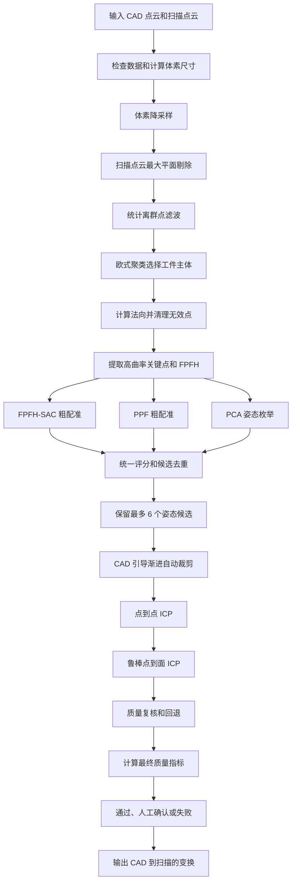

# 模型匹配算法原理与实现详解

## 1. 文档说明

本文档详细说明本项目中“CAD 三维模型与实拍点云自动匹配”所使用的算法。

本文档中的公式全部使用普通文本表达，不需要 Markdown 数学公式插件。公式中的 `*` 表示乘法，`/` 表示除法，`sqrt()` 表示开平方，`norm()` 表示向量长度。

示例：

```text
distance = sqrt(dx*dx + dy*dy + dz*dz)
```

对应含义是三维空间中两点之间的欧氏距离。

主要对应代码：

- `dianyun/dianyun/ModelMatchWorker.cpp`
- `dianyun/dianyun/ModelMatchWorker.h`
- `dianyun/dianyun/ModelMatchController.cpp`
- `dianyun/dianyun/ModelMatchController.h`
- `dianyun/dianyun/MatchTypes.h`
- `dianyun/dianyun/dianyun.cpp`

本文档重点回答四个问题：

1. 每个算法的原理是什么。
2. 公式中的每个变量是什么意思。
3. 当前程序如何使用该算法。
4. 为什么模型匹配需要使用该算法。

---

## 2. 先理解模型匹配要解决的问题

### 2.1 两组输入数据

模型匹配使用两组点云。

第一组是 CAD 点云：

```text
CAD 点云 C = {CAD 点坐标 c_j，CAD 点法向 n_cj}
j = 1, 2, ..., N_c
```

其中：

- `c_j` 表示第 `j` 个 CAD 点的三维坐标。
- `n_cj` 表示第 `j` 个 CAD 点的单位法向。
- `N_c` 表示 CAD 点云总点数。

第二组是扫描点云：

```text
扫描点云 S = {扫描点坐标 s_i，扫描点法向 n_si}
i = 1, 2, ..., N_s
```

其中：

- `s_i` 表示第 `i` 个扫描点的三维坐标。
- `n_si` 表示第 `i` 个扫描点的单位法向。
- `N_s` 表示扫描点云总点数。

CAD 点云来自 STEP 模型表面采样。扫描点云来自 PLY 文件或相机采集结果。

### 2.2 最终要求解什么

模型匹配需要求出一个旋转 `R` 和一个平移 `t`，把扫描点云移动到 CAD 点云的位置：

```text
变换后的扫描点 = R * 原扫描点 + t
```

写成点变量就是：

```text
s_aligned_i = R * s_i + t
```

其中：

- `s_i` 是原始扫描点。
- `s_aligned_i` 是变换后的扫描点。
- `R` 是 3×3 旋转矩阵。
- `t` 是 3×1 平移向量。

为了方便程序计算，旋转和平移组合成一个 4×4 矩阵：

```text
    | R00 R01 R02 tx |
T = | R10 R11 R12 ty |
    | R20 R21 R22 tz |
    |  0   0   0   1 |
```

对三维点使用齐次坐标：

```text
| x_after |       | x_before |
| y_after |       | y_before |
| z_after | = T * | z_before |
|    1    |       |    1     |
```

### 2.3 当前代码中的变换方向

配准算法内部主要计算：

```text
T_scan_to_cad
```

它表示“扫描点云坐标系到 CAD 坐标系”的变换：

```text
CAD 坐标中的扫描点 = T_scan_to_cad * 原扫描点
```

最终返回给界面和焊缝映射的 `MatchResult::T_final` 是相反方向：

```text
T_final = inverse(T_scan_to_cad)
```

所以：

```text
T_final = T_cad_to_scan
```

后续将 CAD 上的焊缝映射到扫描点云时，应使用：

```text
扫描坐标中的焊缝点 = T_final * CAD 焊缝点
```

这是整个项目中最容易混淆的地方之一。

### 2.4 为什么只允许旋转和平移

正确的旋转矩阵应满足：

```text
transpose(R) * R = I
```

其中：

- `transpose(R)` 是 `R` 的转置。
- `I` 是 3×3 单位矩阵。

正确旋转还应满足：

```text
det(R) = +1
```

其中 `det(R)` 是旋转矩阵的行列式。

当 `det(R) = -1` 时，变换包含镜像反射。当前程序会拒绝这种候选。

当前匹配只允许：

- 旋转；
- 平移。

不允许：

- 缩放；
- 剪切；
- 镜像；
- 非刚性变形。

原因是同一个真实工件与 CAD 模型应具有相同尺寸。如果扫描尺寸不正确，应检查单位和相机标定，而不是用缩放掩盖问题。

---

## 3. 当前模型匹配的完整流程



当前方案不是只调用一次 ICP，而是由多个互补算法组成。

这样设计是为了处理：

- 扫描点云不完整；
- 工作台和底板干扰；
- 夹具与工件连接；
- 深度相机飞点；
- 工件具有重复结构；
- 工件具有对称性；
- 单个粗配准算法偶尔失败；
- ICP 容易进入错误的局部最优。

---

## 4. CAD 尺度与体素尺寸

### 4.1 CAD 包围盒

程序先找到 CAD 点云在三个方向的最小值和最大值：

```text
CAD 最小点 = (x_min, y_min, z_min)
CAD 最大点 = (x_max, y_max, z_max)
```

三个方向的长度为：

```text
dx = x_max - x_min
dy = y_max - y_min
dz = z_max - z_min
```

CAD 包围盒对角线为：

```text
D_cad = sqrt(dx*dx + dy*dy + dz*dz)
```

`D_cad` 用来表示 CAD 模型的整体尺寸。

### 4.2 动态体素尺寸

当前程序使用：

```text
leaf_size = max(D_cad * leafSizeFactor, 0.5)
```

默认：

```text
leafSizeFactor = 0.01
```

因此，如果：

```text
D_cad = 200 mm
```

则：

```text
leaf_size = max(200 * 0.01, 0.5)
          = max(2, 0.5)
          = 2 mm
```

本文后面使用 `L` 表示 `leaf_size`。

### 4.3 为什么使用相对尺度

如果所有距离阈值都固定为 2 mm，那么它可能适合 200 mm 的工件，却不适合 20 mm 或 2000 mm 的工件。

当前程序把多数距离写成 `L` 的倍数：

| 用途 | 当前距离 |
|---|---:|
| 平面内点距离 | `1.25 * L` |
| 聚类连接距离 | `2.0 * L` |
| 法向搜索半径 | `3.0 * L` |
| 曲率搜索半径 | `4.0 * L` |
| FPFH 搜索半径 | `6.0 * L` |
| 粗配准对应距离 | `4.0 * L` |
| 点到点 ICP 对应距离 | `3.0 * L` |
| 点到面 ICP 对应距离 | `2.0 * L` |
| 最终质量评价距离 | `2.5 * L` |

这样，匹配参数会随工件尺寸自动变化。

### 4.4 必须满足的前提

CAD 和扫描点云必须使用相同单位。

例如：

```text
正确：CAD 使用 mm，扫描也使用 mm
错误：CAD 使用 mm，扫描使用 m
```

如果扫描尺寸是 CAD 的 1000 倍，刚体配准无法解决。

---

## 5. 体素降采样

### 5.1 原理

体素降采样把三维空间划分成很多边长为 `L` 的小立方体。

一个体素中可能有多个原始点：

```text
体素中的点 = p_1, p_2, ..., p_m
```

程序用这些点的平均坐标代表整个体素：

```text
体素代表点 = (p_1 + p_2 + ... + p_m) / m
```

分别看三个坐标：

```text
x_center = (x_1 + x_2 + ... + x_m) / m
y_center = (y_1 + y_2 + ... + y_m) / m
z_center = (z_1 + z_2 + ... + z_m) / m
```

### 5.2 当前代码怎么使用

CAD 和扫描点云都会先执行 `pcl::VoxelGrid`：

```cpp
grid.setLeafSize(m_leafSize, m_leafSize, m_leafSize);
```

体素降采样被放在所有复杂计算之前。

### 5.3 为什么需要使用

完整扫描可能有数百万个点。如果直接计算法向、FPFH 和 ICP：

- 计算时间很长；
- 内存占用很大；
- 导入和匹配容易卡顿；
- 高密度区域会过度影响评分；
- 相机采样纹理会干扰真实几何。

降采样能显著减少点数，同时保留工件整体形状。

### 5.4 参数如何影响结果

`leafSizeFactor` 太小：

- 保留点太多；
- 运行慢；
- 噪声较多；
- 法向更容易抖动。

`leafSizeFactor` 太大：

- 小孔、窄槽和棱边可能消失；
- 关键点数量减少；
- 精配准精度下降。

默认值 `0.01` 是速度与细节之间的折中。

---

## 6. RANSAC 最大平面剔除

### 6.1 平面方程

三维平面可以写成：

```text
a*x + b*y + c*z + d = 0
```

其中 `(a, b, c)` 是平面法向方向。

点 `p = (x, y, z)` 到平面的距离为：

```text
distance_to_plane =
    abs(a*x + b*y + c*z + d)
    / sqrt(a*a + b*b + c*c)
```

### 6.2 RANSAC 做什么

RANSAC 的基本过程：

1. 随机选择 3 个点。
2. 用这 3 个点拟合一个平面。
3. 计算其他点到该平面的距离。
4. 距离小于阈值的点称为内点。
5. 重复多次。
6. 选择内点最多的平面。

内点条件为：

```text
distance_to_plane < plane_threshold
```

当前：

```text
plane_threshold = 1.25 * L
```

### 6.3 RANSAC 迭代次数的原理

假设：

- `w` 是数据中真实平面点的比例。
- 每次需要随机选 `s` 个点。
- `p` 是希望至少成功一次的概率。

理论迭代次数为：

```text
iterations = log(1 - p) / log(1 - w^s)
```

平面拟合最少需要 3 个点，所以：

```text
s = 3
```

当前代码直接将最大迭代次数设为 500。

### 6.4 当前代码的删除条件

最大平面不会无条件删除。只有同时满足：

```text
平面点数 / 当前总点数 > 0.15
```

并且：

```text
删除平面后剩余点数 >= 100
```

才会真正删除。

### 6.5 为什么要使用

扫描中的工作台或底板通常：

- 面积大；
- 点数多；
- 形状简单；
- 与 CAD 中的大平面容易形成错误对应。

如果不删除，ICP 可能把 CAD 的工件平面贴到工作台上。

### 6.6 风险

如果工件自身最大的表面也是大平面，它也可能被误认为底板。

若发现工件主体被删除，可考虑：

- 减小 `1.25 * L`；
- 提高 15% 的平面占比条件；
- 加入工作台高度范围；
- 使用已知重力方向；
- 使用相机标定后的固定工作空间。

---

## 7. 统计离群点滤波 SOR

### 7.1 原理

对每个点 `p_i`，查找它最近的 `K` 个点。

计算该点到这些近邻的平均距离：

```text
mean_distance_i =
    (d_i1 + d_i2 + ... + d_iK) / K
```

然后统计所有点的平均近邻距离：

```text
global_mean =
    (mean_distance_1 + ... + mean_distance_N) / N
```

再计算标准差：

```text
global_std =
    sqrt(
        sum((mean_distance_i - global_mean)^2) / N
    )
```

若某点满足：

```text
mean_distance_i >
    global_mean + alpha * global_std
```

则认为它是离群点。

### 7.2 当前参数

```text
K = 50
alpha = 1.0
```

对应代码：

```cpp
sor.setMeanK(50);
sor.setStddevMulThresh(1.0);
```

### 7.3 为什么要使用

深度相机常产生孤立飞点。飞点会：

- 扩大点云包围盒；
- 产生错误法向；
- 形成无效 FPFH；
- 增大 ICP 残差；
- 影响工件聚类。

SOR 根据局部密度把这些孤立点删除。

### 7.4 参数调节

`K` 增大：

- 统计更稳定；
- 计算更慢；
- 可能误删薄小结构。

`alpha` 减小：

- 过滤更严格；
- 删除点更多。

`alpha` 增大：

- 保留点更多；
- 也可能保留飞点。

---

## 8. 欧式聚类与自动工件选择

### 8.1 欧式聚类原理

如果两点距离小于聚类阈值，则认为它们在空间上相连：

```text
norm(p_i - p_j) < cluster_tolerance
```

当前：

```text
cluster_tolerance = 2.0 * L
```

通过不断扩展相邻点，得到多个连通区域：

```text
cluster_1, cluster_2, ..., cluster_m
```

每个聚类至少需要：

```text
cluster_point_count >= 40
```

### 8.2 每个聚类的尺寸

对每个聚类计算包围盒对角线：

```text
D_cluster =
    sqrt(dx_cluster^2 + dy_cluster^2 + dz_cluster^2)
```

聚类与 CAD 的尺寸比：

```text
size_ratio = D_cluster / D_cad
```

当前把以下范围视为尺寸合理：

```text
0.45 <= size_ratio <= 1.35
```

### 8.3 当前聚类评分

每个聚类的分数为：

```text
cluster_score =
    log(1 + cluster_point_count)
    - 2 * abs(log(max(size_ratio, 0.001)))
    + plausible_bonus
```

其中：

```text
如果 0.45 <= size_ratio <= 1.35：
    plausible_bonus = 3
否则：
    plausible_bonus = 0
```

选择分数最大的聚类作为工件主体。

### 8.4 计算示例

假设某聚类：

```text
cluster_point_count = 5000
size_ratio = 1.10
plausible_bonus = 3
```

则：

```text
cluster_score =
    log(5001)
    - 2 * abs(log(1.10))
    + 3
```

这个评分会同时奖励：

- 点数较多；
- 尺寸接近 CAD；
- 尺寸位于合理范围。

### 8.5 为什么不能只选最大聚类

场景中最大的连通区域可能是：

- 工作台；
- 夹具；
- 背景；
- 工件和附件的组合。

当前算法同时考虑点数和尺寸，降低选错主体的概率。

### 8.6 尺寸警告

如果：

```text
size_ratio > 1.08
```

程序会提示扫描主体比 CAD 大 8% 以上。

可能原因：

- 仍包含夹具或定位环；
- 工件和附件连在一起；
- 点云标定比例错误；
- CAD 与扫描单位不同。

该警告不会直接终止匹配，因为后续 CAD 引导裁剪仍可能去除附件。

---

## 9. 法向估计

### 9.1 法向是什么

法向是垂直于局部表面的单位向量。

例如：

```text
水平向上的平面法向约为 (0, 0, 1)
竖直朝右的平面法向约为 (1, 0, 0)
```

法向用于：

- FPFH；
- PPF；
- 点到面 ICP；
- 法向一致性评价；
- 自动裁剪。

### 9.2 局部邻域

对每个点 `p_i`，取距离小于 `3 * L` 的邻点：

```text
neighbor_set_i =
    {p_j | norm(p_j - p_i) < 3*L}
```

### 9.3 邻域质心

```text
center_i =
    (p_1 + p_2 + ... + p_m) / m
```

### 9.4 协方差矩阵

对邻域中每个点计算：

```text
offset_j = p_j - center_i
```

协方差矩阵为：

```text
Cov =
    sum(offset_j * transpose(offset_j)) / m
```

`Cov` 是一个 3×3 矩阵，表示邻域点在不同方向上的分布程度。

### 9.5 特征值与法向

对 `Cov` 做特征分解：

```text
Cov * v_k = lambda_k * v_k
```

假设：

```text
lambda_0 <= lambda_1 <= lambda_2
```

最小特征值 `lambda_0` 对应的方向 `v_0`，就是局部法向：

```text
normal = v_0
```

原因是表面上的点主要沿两个切向方向分布，在垂直表面的方向上变化最小。

### 9.6 曲率近似

局部表面变化率可近似表示为：

```text
curvature =
    lambda_0 / (lambda_0 + lambda_1 + lambda_2)
```

含义：

- 平面区域：`lambda_0` 很小，曲率接近 0。
- 边缘或弯曲区域：曲率较大。

### 9.7 当前代码怎么使用

程序使用 `NormalEstimationOMP` 并行计算法向。

随后删除：

- 坐标无效的点；
- 法向包含 `NaN` 的点；
- 法向长度过小的点。

保留法向会重新归一化：

```text
unit_normal = normal / norm(normal)
```

### 9.8 为什么比较法向时取绝对值

无组织点云中：

```text
n
```

和：

```text
-n
```

都可能表示同一个表面方向。

因此程序常使用：

```text
normal_similarity = abs(dot(normal_1, normal_2))
```

其中 `dot()` 表示点积。

这样可以容忍法向整体翻转。

---

## 10. 高曲率关键点

### 10.1 为什么要提取关键点

大平面内部的点局部形状几乎相同，不能有效区分位置。

更有区分力的区域包括：

- 棱边；
- 孔口；
- 凹槽；
- 圆弧边界；
- 尖角；
- 曲率发生明显变化的位置。

所以粗配准优先使用高曲率关键点。

### 10.2 主曲率

一个曲面点通常有两个主要弯曲方向，对应两个主曲率：

```text
pc1
pc2
```

当前主曲率搜索半径：

```text
curvature_radius = 4 * L
```

### 10.3 当前显著性分数

每个点的显著性为：

```text
saliency =
    abs(pc1)
    + abs(pc2)
    + abs(curvature)
```

程序按 `saliency` 从高到低排序。

### 10.4 关键点保留数量

先限制配置比例：

```text
effective_percentile =
    clamp(edgePercentile, 0.15, 0.45)
```

其中 `clamp(value, min, max)` 表示：

```text
如果 value < min，取 min
如果 value > max，取 max
否则取 value
```

请求保留数量：

```text
requested_count =
    ranked_point_count * effective_percentile
```

最终数量：

```text
keep_count =
    min(
        3000,
        max(
            min(400, ranked_point_count),
            requested_count
        )
    )
```

默认：

```text
edgePercentile = 0.25
```

也就是通常保留显著性最高的前 25%，最少尽量保留 400 点，最多保留 3000 点。

### 10.5 特征不足时的回退

如果有效描述子少于 100 个：

1. 从完整点云均匀取最多 2000 个点重新计算。
2. 如果仍少于 100 个，则对完整降采样点云计算。

这样可以避免模型表面较平滑时，因为关键点过少而直接失败。

---

## 11. FPFH 局部特征

### 11.1 FPFH 的作用

FPFH 为每个关键点生成一个 33 维特征描述子。

它描述的是：

- 当前点附近表面的弯曲方式；
- 当前点与邻点法向之间的关系；
- 局部形状是平面、边缘、圆弧还是角点。

FPFH 的目标是让 CAD 中的某个关键点，可以在扫描点云中找到具有相似局部形状的点。

### 11.2 点对局部坐标系

对中心点 `p_i` 和邻点 `p_j`：

```text
d = normalize(p_j - p_i)
u = normal_i
v = normalize(cross(d, u))
w = cross(u, v)
```

其中：

- `normalize()` 表示向量归一化。
- `cross()` 表示叉积。
- `u, v, w` 构成局部坐标系。

### 11.3 三个角度特征

```text
alpha = dot(v, normal_j)
phi   = dot(u, d)
theta = atan2(
            dot(w, normal_j),
            dot(u, normal_j)
        )
```

这些量描述：

- 两个点的法向关系；
- 邻点相对中心点的方向；
- 局部表面的空间变化。

### 11.4 SPFH

对中心点与所有邻点计算 `alpha`、`phi`、`theta`，并形成直方图：

```text
SPFH(p_i) =
    histogram(alpha, phi, theta)
```

### 11.5 FPFH

FPFH 在当前点的 SPFH 基础上，加入邻点的 SPFH：

```text
FPFH(p_i) =
    SPFH(p_i)
    + average(
        SPFH(neighbor_j) / distance_weight_j
      )
```

因此 FPFH 不只描述当前点，还包含周围邻域的几何信息。

### 11.6 当前参数

```text
FPFH 搜索半径 = 6 * L
```

程序只为关键点生成描述子，但邻域搜索使用完整降采样表面。

### 11.7 为什么使用 FPFH

FPFH 的优点：

- 对刚体旋转较稳定；
- 能表达局部几何；
- 比完整 PFH 更快；
- PCL 有成熟实现；
- 可直接用于基于随机采样的粗配准。

### 11.8 FPFH 为什么会失败

常见原因：

- 大面积平面没有明显局部特征；
- 多个圆弧或棱边形状相似；
- 扫描缺失破坏局部邻域；
- 法向噪声大；
- CAD 和扫描密度差异过大；
- FPFH 搜索半径不适合当前结构。

因此本项目没有只依赖 FPFH。

---

## 12. FPFH-SAC 粗配准

### 12.1 基本思想

FPFH-SAC 的过程：

1. 根据 FPFH 相似度寻找候选点对应。
2. 随机选取 3 对对应点。
3. 求一个旋转和平移。
4. 检查该变换能支持多少点。
5. 重复很多次。
6. 保留有效姿态候选。

### 12.2 对应点的刚体目标

假设有 `M` 对对应点：

```text
扫描点：s_1, s_2, ..., s_M
CAD 点： c_1, c_2, ..., c_M
```

目标是让总平方距离最小：

```text
error =
    sum(
        norm(R*s_k + t - c_k)^2
    )
```

也就是寻找：

```text
让 error 最小的 R 和 t
```

### 12.3 SVD 刚体解

扫描对应点质心：

```text
center_scan =
    (s_1 + s_2 + ... + s_M) / M
```

CAD 对应点质心：

```text
center_cad =
    (c_1 + c_2 + ... + c_M) / M
```

去中心化：

```text
s_centered_k = s_k - center_scan
c_centered_k = c_k - center_cad
```

构造相关矩阵：

```text
H =
    sum(
        s_centered_k
        * transpose(c_centered_k)
    )
```

对 `H` 进行奇异值分解：

```text
H = U * Sigma * transpose(V)
```

旋转矩阵为：

```text
R =
    V
    * determinant_correction
    * transpose(U)
```

其中 `determinant_correction` 用于保证：

```text
det(R) = +1
```

平移为：

```text
t = center_cad - R * center_scan
```

### 12.4 当前参数

当前使用 `SampleConsensusPrerejective`：

| 参数 | 当前值 |
|---|---:|
| 独立运行次数 | 至少 8 次 |
| 每次最大迭代 | 25000 |
| 每次随机样本 | 3 对 |
| 每点候选特征近邻 | 18 |
| 多边形边长相似度 | 0.75 |
| 最大对应距离 | `4 * L` |
| 默认内点比例 | 0.15 |
| 内点比例限制 | 0.08 到 0.30 |

### 12.5 为什么要运行多次

SAC 具有随机性。一次运行可能没有抽到正确的点对。

多次运行可以产生多个不同姿态，再交给统一质量函数比较。

### 12.6 为什么只保留 `det(R) = +1`

如果：

```text
det(R) < 0
```

说明变换包含镜像。当前任务只接受真实刚体姿态，因此直接拒绝。

---

## 13. PPF 点对特征粗配准

### 13.1 PPF 描述什么

对两个带法向的点：

```text
point_1, normal_1
point_2, normal_2
```

定义：

```text
d = point_2 - point_1
```

PPF 特征包含四项：

```text
PPF =
[
    norm(d),
    angle(normal_1, d),
    angle(normal_2, d),
    angle(normal_1, normal_2)
]
```

向量夹角计算：

```text
angle(a, b) =
    acos(
        dot(a, b) / (norm(a) * norm(b))
    )
```

### 13.2 PPF 的工作过程

1. 对 CAD 中的大量点对计算 PPF。
2. 将 PPF 放入哈希表。
3. 对扫描点对计算 PPF。
4. 在哈希表中查找相似 CAD 点对。
5. 每个相似点对为一个可能姿态投票。
6. 将接近的姿态聚类。
7. 输出得票较高的姿态。

### 13.3 当前代码的点数限制

PPF 点对数量近似为：

```text
point_pair_count ≈ point_count * point_count
```

例如：

```text
500 点约产生 250000 个有序点对
5000 点约产生 25000000 个有序点对
```

所以当前限制：

```text
CAD 最多 500 点
扫描最多 1400 点
```

### 13.4 当前参数

| 参数 | 当前值 |
|---|---:|
| 角度离散步长 | 12 度 |
| 距离离散步长 | `1.5 * L` |
| 场景参考点采样率 | 8 |
| 平移聚类阈值 | `4 * L` |
| 旋转聚类阈值 | 15 度 |
| 每次最多输出姿态 | 5 |

### 13.5 法向方向处理

CAD 法向会根据模型质心调整为大致向外。

扫描执行两次 PPF：

```text
第 1 次：使用原扫描法向
第 2 次：把全部扫描法向乘以 -1
```

这样可以降低整体法向方向相反造成的影响。

### 13.6 变换方向

PCL PPF 输出：

```text
T_cad_to_scan
```

粗配准统一评分需要：

```text
T_scan_to_cad
```

所以：

```text
T_scan_to_cad = inverse(T_cad_to_scan)
```

### 13.7 为什么加入 PPF

FPFH 主要描述单点附近的局部形状。

PPF 描述两个有向点之间的关系。

当局部描述子因缺失或重复结构不可靠时，点对投票仍可能找到正确姿态。

---

## 14. PCA 确定性姿态候选

### 14.1 PCA 做什么

PCA 用点云整体分布估计三个主方向。

先计算点云质心：

```text
center =
    (p_1 + p_2 + ... + p_N) / N
```

去中心化：

```text
offset_i = p_i - center
```

协方差矩阵：

```text
Cov =
    sum(
        offset_i * transpose(offset_i)
    ) / N
```

特征分解：

```text
Cov * axis_k = eigenvalue_k * axis_k
```

三个 `axis_k` 是点云的三个主轴。

### 14.2 直观理解

对一个长方体：

- 最大特征值通常对应最长方向；
- 中间特征值对应次长方向；
- 最小特征值对应最短方向。

因此可以尝试让扫描主轴与 CAD 主轴对齐。

### 14.3 为什么需要枚举

PCA 主轴存在两种不确定性：

1. X、Y、Z 轴可能交换。
2. 每根轴的正方向和负方向都可能互换。

当前程序枚举：

```text
6 种轴排列
×
多个正负号组合
```

只保留：

```text
det(R) > 0.99
```

最终得到 24 个合法旋转候选。

### 14.4 平移

每个旋转候选都让质心对齐：

```text
t = center_cad - R * center_scan
```

### 14.5 为什么保留 PCA

PCA 的优势：

- 不使用随机数；
- 不依赖 FPFH；
- 速度快；
- 在长宽高差异明显时有效；
- 可以作为 FPFH 和 PPF 失败时的后备。

### 14.6 PCA 的局限

PCA 在以下场景容易错误：

- 扫描只包含 CAD 的一部分；
- 工件高度对称；
- 两个方向尺寸接近；
- 扫描仍包含夹具；
- 缺失区域使质心偏移。

所以 PCA 只负责生成候选，不能直接决定最终结果。

---

## 15. 粗配准候选的统一评分

FPFH-SAC、PPF 和 PCA 的内部评分含义不同，不能直接比较。

当前程序把所有候选统一转换为：

```text
T_scan_to_cad
```

然后使用同一个几何质量函数评分。

### 15.1 扫描覆盖率

对每个扫描点：

```text
aligned_scan_i =
    R * scan_i + t
```

在 CAD 中查找最近点：

```text
nearest_cad_i =
    CAD 中距离 aligned_scan_i 最近的点
```

如果：

```text
norm(aligned_scan_i - nearest_cad_i) <= 4 * L
```

则该扫描点被 CAD 支持。

扫描覆盖率：

```text
scan_overlap =
    supported_scan_count / total_scan_count
```

粗候选最低要求：

```text
scan_overlap >= 0.12
```

### 15.2 CAD 反向支持率

反过来，对每个 CAD 点查找最近扫描点。

```text
cad_overlap =
    supported_cad_count / total_cad_count
```

扫描通常只能看到 CAD 的部分表面，所以 `cad_overlap` 不要求接近 1。

### 15.3 法向一致性

对有效对应：

```text
normal_score_i =
    abs(
        dot(
            transformed_scan_normal_i,
            cad_normal_i
        )
    )
```

平均法向一致性：

```text
normal_consistency =
    sum(normal_score_i) / valid_pair_count
```

取值范围：

```text
0 <= normal_consistency <= 1
```

越接近 1，表面方向越一致。

### 15.4 关键特征覆盖率

对扫描关键点执行变换，在 CAD 关键点中查找最近点。

对应成立需要：

```text
关键点距离 <= 3 * L
```

并且：

```text
abs(dot(scan_feature_normal, cad_feature_normal)) >= 0.45
```

关键特征覆盖率：

```text
feature_overlap =
    supported_scan_feature_count
    / total_scan_feature_count
```

存在有效特征时，粗候选最低要求：

```text
feature_overlap >= 0.08
```

### 15.5 空间结构覆盖率

只看覆盖点数仍可能误判。例如，一个大平面局部重合就能产生很多对应点。

当前程序把 CAD 包围盒划分成：

```text
3 × 3 × 3 = 27 个空间单元
```

统计有效对应覆盖了多少单元：

```text
cell_coverage =
    covered_cell_count / valid_cad_cell_count
```

再根据法向主要朝向分为 X、Y、Z 三类：

```text
normal_bin_coverage =
    covered_normal_bin_count
    / valid_normal_bin_count
```

最终：

```text
spatial_coverage =
    0.65 * cell_coverage
    + 0.35 * normal_bin_coverage
```

粗候选最低要求：

```text
spatial_coverage >= 0.12
```

### 15.6 截断 RMSE

粗配准中会有夹具点和错误对应。

程序把所有有效平方残差从小到大排序：

```text
d2_1 <= d2_2 <= ... <= d2_M
```

只保留最小的 70%：

```text
keep_count = max(1, floor(0.70 * M))
```

截断 RMSE：

```text
trimmed_rmse =
    sqrt(
        sum(d2_1 ... d2_keep_count)
        / keep_count
    )
```

这样可以降低少量大误差的影响。

### 15.7 粗配准综合分数

当前分数为：

```text
coarse_score =
    trimmed_rmse
    + 2.00 * L * (1 - scan_overlap)
    + 2.50 * L * (1 - feature_overlap)
    + 1.50 * L * (1 - spatial_coverage)
    + 0.75 * L * (1 - normal_consistency)
    - 0.75 * L * min(cad_overlap, 0.40)
```

如果没有足够的有效特征，则不加入 `feature_overlap` 对应项。

分数越小越好。

### 15.8 计算示例

假设：

```text
L = 2.0
trimmed_rmse = 1.0
scan_overlap = 0.75
feature_overlap = 0.60
spatial_coverage = 0.70
normal_consistency = 0.85
cad_overlap = 0.35
```

则：

```text
coarse_score =
    1.0
    + 2.00 * 2.0 * (1 - 0.75)
    + 2.50 * 2.0 * (1 - 0.60)
    + 1.50 * 2.0 * (1 - 0.70)
    + 0.75 * 2.0 * (1 - 0.85)
    - 0.75 * 2.0 * min(0.35, 0.40)

coarse_score =
    1.0 + 1.0 + 2.0 + 0.9 + 0.225 - 0.525

coarse_score = 4.6
```

### 15.9 为什么不能只看 RMSE

错误姿态可能只让一块大平面局部重合，此时 RMSE 也可能很小。

综合分数同时检查：

- 距离；
- 扫描覆盖；
- CAD 支持；
- 关键结构；
- 空间分布；
- 表面方向。

### 15.10 候选去重

若两个候选满足：

```text
旋转差 < 8 度
```

并且：

```text
平移差 < 3 * L
```

则认为它们属于同一个姿态，只保留分数更好的候选。

最终最多保留 6 个不同姿态进入精配准。

---

## 16. CAD 引导的渐进自动裁剪

### 16.1 为什么粗配准后还要裁剪

预处理后的扫描主体仍可能包含：

- 与工件连接的夹具；
- 定位环；
- 底板残块；
- 与 CAD 无关的突出物。

如果这些点全部进入 ICP，会把正确姿态拉偏。

粗配准已经提供了大致姿态，因此可以利用 CAD 判断哪些扫描点可能属于工件。

### 16.2 裁剪条件

将扫描点变换到 CAD 坐标系。

若：

```text
scan_to_cad_distance <= distance_factor * L
```

并且：

```text
abs(dot(scan_normal, cad_normal)) >= 0.15
```

则保留该扫描点。

### 16.3 三次渐进距离

当前依次使用：

```text
第 1 次：distance_factor = 6.0
第 2 次：distance_factor = 3.5
第 3 次：distance_factor = 2.5
```

也就是：

```text
6.0*L -> 3.5*L -> 2.5*L
```

每次裁剪后执行点到点 ICP，再用更准确的姿态进行下一次裁剪。

### 16.4 最小保留点数

裁剪后至少需要：

```text
minimum_guided_points =
    max(250, 0.10 * original_scan_point_count)
```

例如原扫描有 7000 点：

```text
0.10 * 7000 = 700
minimum_guided_points = max(250, 700) = 700
```

如果保留点不足，说明该粗姿态缺少足够 CAD 支持。

### 16.5 为什么采用“先宽后窄”

如果第一步就用 `2.5 * L`，粗姿态的小误差可能使正确工件点被大量删除。

渐进裁剪的逻辑是：

1. 先宽松保留可能属于工件的点。
2. 用 ICP 改善姿态。
3. 再收紧距离。
4. 逐步去除夹具和背景。

这是完全自动模式能够代替手工 ROI 的关键。

---

## 17. 点到点 ICP 精配准 A

### 17.1 ICP 的基本循环

ICP 每轮执行：

1. 用当前姿态变换扫描点。
2. 为每个扫描点寻找最近 CAD 点。
3. 删除距离过大的对应。
4. 求使对应点总距离最小的刚体增量。
5. 更新姿态。
6. 判断是否收敛。

### 17.2 点到点目标函数

对有效对应点：

```text
source_i = 扫描点
target_i = 最近 CAD 点
```

点到点误差：

```text
point_to_point_error =
    sum(
        norm(
            R * source_i + t - target_i
        )^2
    )
```

目标是寻找使该值最小的 `R` 和 `t`。

### 17.3 当前参数

| 参数 | 当前值 |
|---|---:|
| 最大迭代次数 | 50 |
| 最大对应距离 | `3 * L` |
| RANSAC 离群阈值 | `1.5 * L` |
| 附加对应拒绝距离 | `2 * L` |
| 变换收敛阈值 | `0.0000001` |
| 适应度收敛阈值 | `0.000001` |

### 17.4 变换组合

设粗姿态为：

```text
T_initial
```

ICP 求出的增量为：

```text
delta_T_A
```

阶段 A 的结果为：

```text
T_A = delta_T_A * T_initial
```

矩阵乘法顺序不能交换。

### 17.5 为什么先使用点到点 ICP

点到点 ICP：

- 不完全依赖法向；
- 初始姿态允许范围较大；
- 对边缘和曲面混合场景较稳；
- 适合作为粗配准和点到面 ICP 之间的过渡。

若点到点 ICP 不收敛，程序保留原粗姿态，不让无效结果继续传播。

---

## 18. 鲁棒点到面 ICP 精配准 B

### 18.1 点到面距离

对已变换扫描点 `p`、最近 CAD 点 `q` 和 CAD 法向 `n`：

```text
point_to_plane_distance =
    dot(n, p - q)
```

它表示 `p` 到 `q` 所在切平面的有符号距离。

点到面 ICP 最小化：

```text
point_to_plane_error =
    sum(
        robust_loss(
            dot(n_i, p_i - q_i)
        )
    )
```

### 18.2 为什么点到面通常更快

在平面上，点到点 ICP 会要求源点靠近某个具体目标点。

点到面 ICP 只要求源点靠近目标切平面，因此更符合连续曲面的真实几何，接近正确姿态后通常收敛更快。

### 18.3 六维小增量

每次迭代求一个六维增量：

```text
x =
[
    rotation_x,
    rotation_y,
    rotation_z,
    translation_x,
    translation_y,
    translation_z
]
```

前三项表示小旋转，后三项表示小平移。

### 18.4 线性化

对小旋转，可以近似：

```text
R_small * p ≈ p + rotation_vector cross p
```

当前代码对每个对应构造一行雅可比：

```text
J_i =
[
    p cross n,
    n
]
```

也就是：

```text
J_i =
[
    cross_x,
    cross_y,
    cross_z,
    normal_x,
    normal_y,
    normal_z
]
```

右侧残差：

```text
r_i = -dot(n, p - q)
```

希望：

```text
J_i * x ≈ r_i
```

### 18.5 加权最小二乘

对所有有效对应，最小化：

```text
weighted_error =
    sum(
        weight_i
        * (J_i * x - r_i)^2
    )
```

构造法方程：

```text
A =
    sum(
        weight_i
        * transpose(J_i)
        * J_i
    )
```

```text
b =
    sum(
        weight_i
        * transpose(J_i)
        * r_i
    )
```

求解：

```text
A * x = b
```

当前代码使用 LDLT 分解求解。

### 18.6 Huber 鲁棒权重

当前：

```text
huber_delta = L
```

根据点间距离 `d` 计算：

```text
如果 d <= L：
    huber_weight = 1

如果 d > L：
    huber_weight = L / d
```

例如：

```text
L = 2
d = 1
huber_weight = 1
```

```text
L = 2
d = 8
huber_weight = 2 / 8 = 0.25
```

因此大残差对应不会被完全删除，但影响会明显减小。

### 18.7 法向权重

法向余弦：

```text
normal_cos =
    dot(scan_normal, cad_normal)
```

若：

```text
normal_cos < 0
```

则把 CAD 法向乘以 `-1`。

若修正后：

```text
normal_cos < 0.1
```

说明两个表面方向差异太大，拒绝该对应。

最终权重：

```text
weight =
    huber_weight * normal_cos
```

距离较近、表面方向更一致的对应权重更高。

### 18.8 对应距离和有效点数

只接受：

```text
point_distance <= 2 * L
```

每轮至少需要：

```text
valid_pair_count >= 10
```

否则停止求解。

### 18.9 阻尼

部分扫描可能接近平面。单个平面无法充分约束：

- 沿平面的平移；
- 绕平面法向的旋转。

这会使矩阵 `A` 接近不可逆。

当前程序加入对角阻尼：

```text
max_diagonal =
    max(abs(A 的所有对角元素))
```

```text
damping =
    max(max_diagonal * 0.000001, 0.00000001)
```

```text
A_damped = A + damping * I
```

阻尼可以避免求出极大的错误更新。

### 18.10 单步限制

最大旋转增量：

```text
rotation_step <= 0.05 rad
```

约等于：

```text
0.05 * 180 / pi ≈ 2.86 度
```

最大平移增量：

```text
translation_step <= max(L, 0.001)
```

如果计算值超过限制，程序按比例缩小。

### 18.11 姿态更新

根据六维增量生成：

```text
delta_T
```

每轮：

```text
T_B = delta_T * T_B
```

最终：

```text
T_scan_to_cad_final = T_B * T_A
```

### 18.12 收敛条件

如果同时满足：

```text
rotation_step < 0.0001
translation_step < 0.0001
```

则认为点到面 ICP 收敛。

最大迭代次数默认 50。

### 18.13 为什么点到面放在最后

点到面 ICP 收敛域较小，而且受法向和局部平面退化影响。

所以顺序必须是：

```text
全局粗配准
-> 点到点 ICP
-> 点到面 ICP
```

不能直接从任意初始姿态执行点到面 ICP。

---

## 19. 点到面结果的自动回退

“算法收敛”不等于“姿态正确”。

点到面 ICP 可能在错误位置达到一个局部最小值。

设：

```text
score_A = 阶段 A 的最佳质量
score_B = 阶段 B 的质量
```

如果：

```text
score_B 不是有效数值
```

或者：

```text
score_B > score_A + 0.10 * L
```

程序会回退：

```text
最终姿态 = 阶段 A 姿态
```

这可以防止最后一步优化反而破坏正确结果。

---

## 20. 精配准候选质量

每个粗候选经过自动裁剪和精配准后，重新评分。

定义：

```text
guided_ratio =
    CAD 引导裁剪后保留点数
    / 原扫描点数
```

精配准质量为：

```text
refined_score =
    rmse
    + 2.00 * L * (1 - scan_overlap)
    + 3.00 * L * (1 - feature_overlap)
    + 2.00 * L * (1 - spatial_coverage)
    + 1.50 * L
      * (1 - min(guided_ratio / 0.65, 1))
    + 0.50 * L * (1 - normal_consistency)
    - 0.75 * L * min(cad_overlap, 0.40)
```

分数越小越好。

与粗评分相比，它更强调：

- 关键特征是否对齐；
- 空间结构是否完整；
- 自动裁剪后是否保留足够工件点；
- ICP 后的实际距离误差。

---

## 21. 多解检测

把最终候选按分数从小到大排列：

```text
best_score <= second_score
```

计算：

```text
ambiguity_value =
    second_score / best_score
```

默认阈值：

```text
ambiguityRatio = 1.10
```

如果：

```text
ambiguity_value < 1.10
```

说明次优候选和最优候选非常接近，程序认为存在多解。

### 21.1 示例

```text
best_score = 2.00
second_score = 2.08
ambiguity_value = 2.08 / 2.00 = 1.04
```

因为：

```text
1.04 < 1.10
```

所以结果存在多解，需要人工确认。

### 21.2 多解常见原因

- 工件左右对称；
- 多个圆弧形状相似；
- 多个槽或孔重复；
- 扫描只看到一个局部；
- 特征集中在同一小区域；
- 夹具形成类似 CAD 的结构。

---

## 22. 最终质量指标

最终评价的最大对应距离为：

```text
evaluation_distance = 2.5 * L
```

### 22.1 扫描覆盖率

```text
scan_overlap =
    有 CAD 近邻的扫描点数
    / 扫描总点数
```

含义：扫描工件点中有多少能够贴到 CAD 表面。

### 22.2 CAD 反向支持率

```text
cad_overlap =
    有扫描近邻的 CAD 点数
    / CAD 总点数
```

含义：完整 CAD 表面中有多少被当前扫描观察到。

部分扫描时，该值通常不会很高。

### 22.3 RMSE

假设有效对应距离为：

```text
d_1, d_2, ..., d_M
```

则：

```text
rmse =
    sqrt(
        (d_1^2 + d_2^2 + ... + d_M^2)
        / M
    )
```

RMSE 表示平均距离误差，对大残差较敏感。

### 22.4 P95 残差

把距离从小到大排序：

```text
d_sorted_1 <= ... <= d_sorted_M
```

取 95% 位置处的值：

```text
p95_index =
    floor((M - 1) * 0.95)
```

```text
p95_residual =
    d_sorted[p95_index]
```

含义：约 95% 的有效对应误差不超过该值。

P95 可以发现：

- 平均误差还可以；
- 但局部区域明显错位。

### 22.5 法向一致性

```text
normal_consistency =
    average(
        abs(dot(scan_normal_i, cad_normal_i))
    )
```

解释：

```text
接近 1：表面方向一致
接近 0：表面方向接近垂直
```

### 22.6 关键特征覆盖率

```text
feature_overlap =
    获得 CAD 支持的扫描关键点数
    / 扫描关键点总数
```

用于避免“平面对上了，但孔、槽和圆弧没有对上”的误判。

### 22.7 空间结构覆盖率

```text
spatial_coverage =
    0.65 * 空间单元覆盖
    + 0.35 * 法向方向覆盖
```

用于避免所有有效对应只集中在工件的一个局部。

---

## 23. 最终结果判定

结果分为：

- `Pass`：匹配通过。
- `NeedsReview`：需要人工确认。
- `Fail`：匹配失败。

### 23.1 失败条件

满足任意一项即失败：

```text
rmse 不是有效数值
```

```text
scan_overlap < 0.30
```

```text
cad_overlap < 0.10
```

```text
feature_overlap < 0.15
```

```text
spatial_coverage < 0.18
```

```text
normal_consistency < 0.45
```

```text
rmse > 1.25 * L
```

```text
p95_residual > 2.00 * L
```

### 23.2 需要人工确认条件

没有失败，但满足任意一项：

```text
存在多解
```

```text
点到面 ICP 未收敛
```

```text
scan_overlap < 0.55
```

```text
cad_overlap < 0.25
```

```text
feature_overlap < 0.35
```

```text
spatial_coverage < 0.40
```

```text
normal_consistency < 0.70
```

### 23.3 匹配通过

只有既不满足失败条件，也不满足人工确认条件，结果才是 `Pass`。

### 23.4 为什么分成三级

工业程序不能只输出一个矩阵，还应说明该矩阵是否可信。

- `Fail`：证据表明结果不可靠。
- `NeedsReview`：存在合理姿态，但证据不足。
- `Pass`：多个互补指标共同支持该姿态。

---

## 24. 为什么不能只使用 ICP

ICP 是局部优化算法，必须依赖较好的初始姿态。

可以把误差理解成一片有很多低谷的地形：

```text
真实姿态对应一个低谷
错误的平面重合也可能对应另一个低谷
对称姿态还可能形成多个相似低谷
```

ICP 从初始位置开始，只会走到附近的低谷。

如果初始姿态错误，ICP 可能：

- 把一个平面贴到错误平面；
- 把左侧结构对到右侧；
- 把圆弧对到另一个圆弧；
- 把 CAD 对到夹具；
- 只让一小块局部重合。

因此本项目先使用 FPFH-SAC、PPF 和 PCA 搜索全局姿态，再使用 ICP 做局部精化。

---

## 25. 为什么不能只看 RMSE

考虑两个结果。

结果 A：

```text
只有 10% 点局部贴合
rmse = 0.5
```

结果 B：

```text
80% 点整体贴合
边缘因为扫描缺失存在误差
rmse = 0.8
```

如果只看 RMSE，会错误选择结果 A。

因此当前系统同时使用：

```text
rmse
p95_residual
scan_overlap
cad_overlap
feature_overlap
spatial_coverage
normal_consistency
```

它们分别检查：

- 平均距离；
- 尾部误差；
- 扫描支持；
- CAD 支持；
- 关键结构；
- 空间分布；
- 表面方向。

---

## 26. 为什么当前方案适合部分点云

扫描点云通常只包含 CAD 的可见部分：

```text
扫描表面只是完整 CAD 表面的一部分
```

当前方案通过以下方式适配：

1. 不要求扫描覆盖整个 CAD。
2. 扫描覆盖率与 CAD 支持率使用不同阈值。
3. 粗评分只使用较小的 70% 残差。
4. 三种粗配准方法共同产生候选。
5. 每个候选分别执行精配准。
6. 使用空间结构覆盖避免局部假匹配。
7. CAD 引导裁剪去除夹具和背景。
8. 点到面 ICP 使用鲁棒权重。
9. 检测最优和次优候选是否接近。
10. 证据不足时返回人工确认，而不是强行通过。

---

## 27. 在程序中如何使用

### 27.1 用户操作

1. 点击“导入三维模型”。
2. 选择 STEP 文件。
3. 等待 CAD 表面采样完成。
4. 点击“导入点云模型”或使用相机采集。
5. 等待完整点云后台加载完成。
6. 点击“模型匹配”。
7. 查看预处理、粗候选、ICP 和质量日志。
8. 查看状态为匹配通过、需要人工确认或匹配失败。
9. 匹配通过后，可执行焊缝刚性映射。

### 27.2 默认配置

```cpp
MatchConfig config;
config.leafSizeFactor = 0.01f;
config.edgePercentile = 0.25f;
config.sacRuns = 8;
config.sacInlierFrac = 0.15f;
config.ambiguityRatio = 1.10f;
config.icpMaxIterA = 50;
config.icpMaxIterB = 50;
```

### 27.3 使用最终变换

将单个 CAD 点映射到扫描坐标系：

```cpp
Eigen::Vector4f cadPoint(x, y, z, 1.0f);
Eigen::Vector4f scanPoint = result.T_final * cadPoint;
```

法向只应用旋转，不应用平移：

```cpp
Eigen::Vector3f scanNormal =
    result.T_final.block<3, 3>(0, 0) * cadNormal;
```

将整个 CAD 点云映射到扫描坐标系：

```cpp
pcl::transformPointCloud(
    *cadCloud,
    *cadCloudInScan,
    result.T_final);
```

带法向点云应使用 `transformPointCloudWithNormals`。

### 27.4 使用前检查结果

```cpp
if (!result.success) {
    // 算法执行异常，不使用结果
}

if (result.verdict == MatchVerdict::Fail) {
    // 匹配失败，不进行自动焊缝映射
}

if (result.verdict == MatchVerdict::NeedsReview) {
    // 需要人工查看叠加效果
}
```

---

## 28. 参数调节

| 参数 | 默认值 | 作用 | 增大后的影响 | 减小后的影响 |
|---|---:|---|---|---|
| `leafSizeFactor` | 0.01 | 降采样和整体距离尺度 | 更快但细节减少 | 更精细但更慢 |
| `edgePercentile` | 0.25 | 高曲率关键点比例 | 特征更多、计算更慢 | 特征更集中但可能不足 |
| `sacRuns` | 8 | FPFH-SAC 运行次数 | 成功概率提高、耗时增加 | 更快但随机失败增加 |
| `sacInlierFrac` | 0.15 | SAC 最低内点比例 | 候选更严格 | 更宽松但错误候选增加 |
| `ambiguityRatio` | 1.10 | 多解判定阈值 | 更容易提示多解 | 更容易自动选单一结果 |
| `icpMaxIterA` | 50 | 点到点 ICP 迭代 | 可能更充分收敛 | 可能提前停止 |
| `icpMaxIterB` | 50 | 点到面 ICP 迭代 | 局部优化更充分 | 精细贴合可能不足 |

### 28.1 推荐调参顺序

匹配失败时按以下顺序检查：

1. 检查 CAD 和扫描单位。
2. 检查自动聚类是否选中工件主体。
3. 检查 `L` 是否过大或过小。
4. 检查关键点和 FPFH 数量。
5. 增加 `sacRuns`。
6. 适当降低 `sacInlierFrac`。
7. 最后再调整 ICP 迭代次数。

如果粗姿态错误，增加 ICP 迭代不会解决问题，只会让它更稳定地收敛到错误位置。

---

## 29. 常见失败原因

### 29.1 单位不一致

现象：

- 扫描/CAD 尺寸比远离 1。
- 粗候选全部被拒绝。
- 自动裁剪保留点很少。

处理：

- 检查 STEP 单位。
- 检查相机点云单位。
- 在数据源处统一单位。

### 29.2 扫描缺失太多

现象：

- CAD 支持率很低。
- 关键特征覆盖不足。
- 多个候选分数接近。

处理：

- 调整拍摄角度；
- 使用多视角点云；
- 至少拍到一个非对称结构；
- 对对称工件加入姿态先验。

### 29.3 夹具与工件连通

现象：

- 尺寸比大于 1.08。
- 扫描覆盖高，但 CAD 支持低。
- ICP 被附件拉偏。

处理：

- 查看自动裁剪保留率；
- 改善场景分割；
- 使用已知工作区；
- 减少夹具与目标表面的连接。

### 29.4 大平面假匹配

现象：

- RMSE 较小；
- 关键特征覆盖低；
- 空间结构覆盖低；
- 平面对上了，但孔槽错位。

处理：

- 不要只看 RMSE；
- 查看 `featureOverlapRatio`；
- 查看 `spatialCoverageRatio`；
- 确保高曲率关键点数量足够。

### 29.5 对称多解

现象：

- 最优和次优分数接近；
- 日志报告多解；
- 多个姿态都能局部重合。

处理：

- 人工确认；
- 增加非对称可见区域；
- 使用工装姿态先验；
- 增加已知方向或人工选点约束。

### 29.6 法向质量差

现象：

- FPFH 候选少；
- PPF 不稳定；
- 点到面 ICP 被回退；
- 法向一致性低。

处理：

- 检查点云噪声；
- 适当增加法向搜索半径；
- 避免体素尺寸过小；
- 检查是否大量法向无效。

### 29.7 点到面退化

现象：

- 扫描主要是单个平面；
- 点到面更新不稳定；
- 阶段 B 被回退。

原因：

单个平面无法充分确定沿平面平移和绕法向旋转。

处理：

- 拍摄多个方向表面；
- 保留边缘和曲面；
- 使用阶段 A 结果；
- 加入姿态先验。

---

## 30. 性能分析

设降采样后：

```text
N_c = CAD 点数
N_s = 扫描点数
K_c = CAD 关键点数
K_s = 扫描关键点数
I   = ICP 迭代次数
```

| 阶段 | 近似计算量 | 说明 |
|---|---|---|
| 体素降采样 | 与原始点数成正比 | 只遍历和分桶 |
| KdTree 建树 | `N * log(N)` | 最近邻查询基础 |
| 法向估计 | 约 `N * log(N)` | 还与邻域点数有关 |
| FPFH | 约 `K * log(N)` | 还与邻域点数有关 |
| FPFH-SAC | 与迭代次数成正比 | 每次最多 25000 轮 |
| PPF | 约 `N_c * N_c` | 所以限制模型点数 |
| PCA | 与点数成正比 | 速度很快 |
| ICP | 约 `I * N_s * log(N_c)` | 每轮执行最近邻 |

当前主要性能策略：

- 复杂计算前先降采样；
- PPF CAD 点数限制为 500；
- 粗特征只在关键点上计算；
- 粗配准后自动裁剪；
- 重计算放在工作线程。

---

## 31. 当前算法的能力边界

当前方案可以处理：

- 大角度旋转和平移；
- 不完整扫描；
- 一定程度的飞点和噪声；
- 大平面背景；
- 多个连通区域；
- 部分夹具干扰；
- 法向整体翻转；
- 多个粗姿态；
- 对称导致的多解提示。

当前方案不能直接解决：

- CAD 和扫描单位不一致；
- 明显非刚性变形；
- 实物几何与 CAD 不一致；
- 只看到单个无特征平面；
- 完全对称且没有姿态先验；
- 镜像关系；
- 极端稀疏或严重缺失；
- 相机系统性标定畸变。

---

## 32. 后续可扩展方向

### 32.1 多分辨率配准

使用三个体素尺寸：

```text
L_coarse > L_middle > L_fine
```

先在大体素下快速搜索，再逐步使用更细点云优化。

### 32.2 更鲁棒的全局注册

可以引入 TEASER++ 等方法，增加高外点比例下的粗配准候选。

### 32.3 基于相机可见性的评价

根据相机视点计算 CAD 理论可见表面，只评价可见区域，使 CAD 支持率更符合实际扫描过程。

### 32.4 多视角融合

将多个角度的点云融合后再匹配，可以增加：

- 可见表面；
- 非对称结构；
- 法向方向；
- 姿态约束。

### 32.5 姿态不确定度

点到面法方程中的矩阵 `A` 可以反映姿态约束强弱。

简化理解：

```text
pose_uncertainty
    与 inverse(A) 的大小相关
```

如果 `A` 接近不可逆，说明某些旋转或平移方向缺乏约束。

### 32.6 使用任务先验

如果工件总是位于固定工作台，可加入：

- 高度范围；
- 重力方向；
- 允许朝向；
- 固定夹具坐标系；
- 相机外参。

这些先验可以减少对称多解和搜索时间。

---

## 33. 代码与算法对应关系

| 功能 | 代码位置 |
|---|---|
| 完整匹配流程调度 | `ModelMatchWorker::process()` |
| 数据检查和异常保护 | `ModelMatchWorker::process()` |
| 体素、平面、SOR、聚类 | `ModelMatchWorker::preprocess()` |
| 法向估计和无效点清理 | `ModelMatchWorker::preprocess()` |
| 主曲率关键点和 FPFH | `ModelMatchWorker::extractEdgeFeatures()` |
| 关键特征覆盖 | `ModelMatchWorker::evaluateFeatureOverlap()` |
| 空间结构覆盖 | `ModelMatchWorker::evaluateSpatialCoverage()` |
| FPFH-SAC、PPF、PCA | `ModelMatchWorker::coarseRegistration()` |
| 粗候选评分和去重 | `ModelMatchWorker::coarseRegistration()` |
| CAD 引导自动裁剪 | `ModelMatchWorker::extractCadGuidedScan()` |
| 点到点 ICP | `ModelMatchWorker::fineRegistrationA()` |
| 鲁棒点到面 ICP | `ModelMatchWorker::fineRegistrationB()` |
| RMSE、P95 和覆盖评价 | `ModelMatchWorker::evaluateAlignment()` |
| 结果判定 | `ModelMatchWorker::classifyResult()` |
| 配置与结果结构 | `MatchTypes.h` |
| 工作线程控制 | `ModelMatchController` |
| 界面触发和显示 | `dianyun.cpp` |

---

## 34. 修改算法前的检查清单

- [ ] 已确认 `T_final` 是 CAD 到扫描点云的变换。
- [ ] 没有把缩放或镜像加入刚体姿态。
- [ ] CAD 与扫描使用相同单位。
- [ ] 新距离参数优先使用 `L` 的倍数。
- [ ] 预处理后两组点云都至少有 100 点。
- [ ] 法向为有效单位向量。
- [ ] 特征点与特征描述子数量一致。
- [ ] 新粗配准算法输出统一为扫描到 CAD。
- [ ] 所有候选都经过统一评分。
- [ ] ICP 失败不会覆盖已有姿态。
- [ ] 不能只根据 RMSE 判定通过。
- [ ] 对称或多解场景仍会进入人工确认。
- [ ] 焊缝映射使用 `T_final`。
- [ ] 同时使用成功样本和失败样本测试。

---

## 35. 总结

当前模型匹配不是依赖单一算法，而是使用一条多阶段流水线：

1. 体素降采样减少计算量。
2. RANSAC、SOR 和聚类清理场景。
3. 法向、曲率和 FPFH 提取局部几何。
4. FPFH-SAC、PPF 和 PCA 共同搜索粗姿态。
5. 综合覆盖率、特征、空间结构、法向和距离评价候选。
6. CAD 引导裁剪自动去除夹具和背景。
7. 点到点 ICP 提供稳健局部收敛。
8. 鲁棒点到面 ICP 精细贴合表面。
9. 质量回退防止最后一步破坏结果。
10. 多项指标和多解检测决定是否可信。
11. 最终输出 CAD 到扫描点云的刚体变换。

这套方案适合“完整 CAD 对部分实拍点云”的匹配任务。它的可靠性来自多个算法相互补充，而不是来自某一个 ICP 适应度数值。
